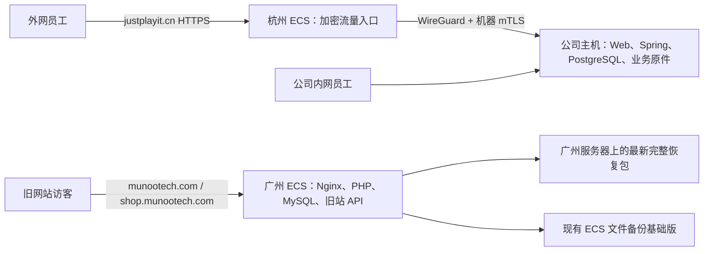

# 服务器部署、备份与迁移总手册

适用：换阿里云账号、换 ECS、换地域、换公司主机、恢复数据库与业务文件，以及迁移后的备份、证书和外网检查。维护日期：2026-11-02。后续每次实际部署或迁移都更新本文的现场记录；操作命令和程序合同继续以本文链接的专用 Runbook 为准。

本文是运维交接入口，**不是已经执行迁移的回执**。本次编写只做只读核查，没有购买资源、修改 DNS、迁移数据库、启用云接管或提交带宽变更。账户密码、AccessKey、令牌、数据库口令、私钥和恢复口令均不写入本文或 Git。

## 1. 先按这张表选择路线

| 你要做什么 | 从哪里开始 | 业务数据是否搬动 |
|---|---|---|
| justplayit.cn 换云服务器 / 换云账号 | 第 5 节「ERP 云入口」 | 公司主库和业务文件不搬动；重新部署云入口和机器身份 |
| munootech.com / shop.munootech.com 换服务器 | 第 6 节「广州旧站」 | MySQL、网站文件、配置和相关服务成套迁移 |
| 公司 ERP 主机换硬件 / 换系统 | 第 7 节「公司 ERP 主机」 | PostgreSQL、原件、历史密钥、配置及对应发行成套恢复 |
| 只想找备份或检查自动备份 | 第 3 节「备份」和第 9 节「日常检查」 | 先核验，不直接覆盖生产 |
| 想把静态资源提前放到云上 | 第 8 节「静态资源」 | 只涉及公开程序资源；目前尚未启用 |
| 切换后异常，需要退回旧服务器 | 第 10 节「回退」 | 入口回退和主数据库回退必须分别处理 |

执行顺序固定为：**盘点 → 保全恢复材料 → 准备目标 → 隔离验证 → 切换验收 → 建立新备份 → 收回旧权限和清理旧资源**。目标没有通过验收，就保持原服务继续提供业务。

用户约束：保持外网连接和业务数据；保持现有费用范围，不自动购买 ECS/云盘/快照/CDN/备份升级；不在个人电脑存业务备份。2026-11-02 用户明确选择保留云入口 **1 Mbps**，取消 20 Mbps 调整；新账号也不能沿用未提交的 20 Mbps 草稿。新机器、迁移期双机、镜像/快照、流量、存储及恢复下载是否收费，执行时先核对真实报价和授权。

## 2. 现有服务器分别做什么

### 2.1 三套角色不要混用



| 角色 | 本次现场基线 | 应部署的内容 | 不应按此角色恢复的内容 |
|---|---|---|---|
| 杭州 ERP 云入口 | cn-hangzhou；`i-bp135tzt9iietrph7g3c`；当时公网 `218.244.155.87`；Alibaba Cloud Linux 4，4 核 / 8 GiB / 40 GiB；1 Mbps 按流量 | 独立 Nginx stream、WireGuard、云机器证书；如已启用则另有独立管理控制面 | 不在这里恢复公司 PostgreSQL，不复制公司员工 TLS 私钥、业务凭据或办公室网段路由 |
| 公司 ERP 主机 | 管理 SSH 别名 `uten-imp-server`；当时 `/opt/uten-imp/current` 指向 `releases/v2.5.43` | Java 21 / Spring、PostgreSQL 16、LAN Nginx、专用远程 Nginx、媒体、内部备份和受控证书续期 | 不用旧网站 MySQL 包替代 ERP 备份，不从退役 cloud 应用模板建立第二个业务写主 |
| 广州旧站与 MySQL | cn-guangzhou；`i-7xv0fcbcm585gio552n0`；当时公网 `8.134.153.196`；Alibaba Cloud Linux 3，2 核 / 2 GiB / 40 GiB | 宝塔、MySQL 5.7.40、Nginx、PHP 8.0/8.2、`slayfish-api` 和网站文件 | 不把这台当成 justplayit.cn 的 ERP 主库 |

这些 ID、IP、软件版本和数据量只用于识别本次现场，**不是新服务器要照抄的永久参数**。新机的发行版、目录、设备名、内网网段、证书身份和账号资源都要重新盘点。仓库还包含其他候选/暂停方案，不能仅因源码或旧手册存在就当作现网已部署。

### 2.2 已核查和未启用的状态

| 项目 | 截至本次核查的状态 |
|---|---|
| ERP 外网入口、公司应用与 LAN Nginx | 服务 active；外网健康检查通过；不代表所有业务和真实员工已验收 |
| Web 传输压缩 | 外网专用 Nginx 已使用 gzip 6，TTF/OTF 已声明 MIME 并压缩；原发行文件未修改 |
| ERP 云端静态资源副本与自动轮换 | **尚未启用**；不能把规划描述为已部署 |
| ERP 云入口 20 Mbps | **未提交，用户选择维持 1 Mbps** |
| 广州 MySQL / API / Nginx / 两套 PHP / crond | 只读核查为 active；原 MySQL 数据目录 `/www/server/data/` 保留 |
| 广州每天只留最新完整一套恢复包 | 已启用，见第 3 节；新包通过恢复校验后才删除旧包 |
| 公司 pgBackRest / paired 定时器 | enabled；pgBackRest 两仓 info 状态 ok；本轮没有重新执行恢复演练 |
| 公司云端 DR snapshot / backup 定时器 | 本次检查均 disabled；不能据仓库实现或旧云端目录声称持续异地备份已启用 |

远程账号按现行 `users.remote_access` 及业务权限判断。ADR-183 顶部 2026-10-29 修订已退役旧远程 MFA/全局开关层；旧部署文字中的「先绑定旧 MFA 才能使用」不能覆盖当前实际实现。网络隔离、每次授权复核与唯一业务写主仍保留。管理控制面的独立认证合同另看专用手册，不能套用员工入口修订。

## 3. 备份在哪里，怎样才算成功

### 3.1 广州旧站：已启用的单套服务器恢复包

| 项目 | 当前入口 |
|---|---|
| 最新成功包和元数据 | `/www/backup/server-recovery/`，root 私有；成功包名称 `server-<UTC时间>-<标识>.tar` |
| 生成与校验控制器 | `/usr/local/sbin/uten-server-recovery` |
| 受限作业 | `/etc/systemd/system/uten-server-recovery.service` |
| 每日调度 | `/etc/cron.d/uten-server-recovery`，Asia/Shanghai 03:17 |
| 完成回执 | `/www/backup/server-recovery/completion-receipt.json`，只证明对应完成时间 |
| 日志 | `/var/log/uten-server-recovery.log` 及 `journalctl -u uten-server-recovery.service` |

一套包内有 `mysql-all.sql.gz`、`panel-config.zip`、`website-files.tar.gz`、`service-config.tar.gz` 和 `manifest.json`。SQL 包含全部数据库、用户/权限、过程、触发器及事件；面板 ZIP 和服务配置含敏感材料，不能公开下载、贴进工单或放进 Git。

稳态保留 **1 套完整成功包**。生成时允许旧成功包、新候选和隔离校验副本暂时并存；必须预留这段峰值空间，不能先删除唯一有效旧包腾空间。任何导出、磁盘空间、压缩/摘要、数据库实际导入或校验失败，都保留旧成功包。临时文件、失败候选、日志、必要 binlog 和云供应商的备份点都不算另一套完整业务包。

已验证的一个恢复点：`server-20261102T042902Z-841ed007.tar`，837,621,760 字节；实际隔离 MySQL 导入和导出快照中的业务行数比对、SQLite 完整性、ZIP/gzip 校验通过。该次快照含 116 张业务表；未来应按新 manifest 和实际导出校验，不能把固定 116 或旧行数当成永远正确。该包不承诺恢复到备份之后任意时刻；记录的 binlog 边界是保守保留边界，**不是精确快照重放坐标**。

当前调度内容如下；换机时只在第 6 节验证完成后安装并启用：

```cron
SHELL=/bin/bash
PATH=/usr/local/sbin:/usr/local/bin:/usr/sbin:/usr/bin:/sbin:/bin
MAILTO=""
CRON_TZ=Asia/Shanghai
17 3 * * * root /usr/bin/systemctl start uten-server-recovery.service >> /var/log/uten-server-recovery.log 2>&1
```

当前作业经 nice/IO 限速、CPU 50%、内存 768 MiB、`PrivateNetwork=yes` 运行，MySQL 经本地 socket 访问；这可限制与在线业务争用。换机不能只复制脚本后直接裸跑 `--backup`；其前置检查会核对受限运行环境。设备限速当前绑定 `/dev/vda`，目标机设备不同必须重新核对。旧宝塔数据库备份任务及面板自动多份备份已停用，迁移后不能被面板默认安装又自动开启。

**迁移交接的已知缺口：**本次只读检查发现，成功包里的控制器 SHA256 为 `c3e5a0553718dbf58da2c305cb75c044f446b2555ebc422ad87e8ea19623756f`，而当前服务器控制器为 `50b8e4692c709ed69e910bd0f701d2479152e15fb765bd5a11622909b6003b1e`；该包内运维成员未包含最新 cron。这不推翻业务快照的已验证恢复结果，但**不能把恢复该包等同于已恢复最新自动备份机制**。计划换机时，源机仍可管理阶段必须按第 4 节另行成套移交最新脚本、unit、cron、清理/日志配置，并核对摘要；未完成则不退役源机。若源机已丢失，只能按已验证内容先恢复业务，旧自动任务保持禁用，由维护人重建和验证，不能照搬包中的旧脚本直接启用。

### 3.2 阿里云 ECS 文件备份基础版

保留原有基础版计划和账号中的恢复访问权。现行产品的备份点锁定、不能手动删除，保留 30 天；不会因为本机只保留一包就变成云端只留一点，也不占 ECS 的业务目录空间。不能通过取消备份或删除客户端来实现「只留一份」。基础版是文件备份，运行中的 MySQL 数据文件本身不能替代第 3.1 节经一致性导出与实际导入验证的恢复包。[阿里云文件备份基础版](https://help.aliyun.com/zh/cloud-backup/user-guide/ecs-file-backup-essential-edition)

新账号、新实例、地域和挂载容量必须重新确认支持范围与免费额度/实际费用；不要把当前账号的免费使用状态写成新账号永久免费。旧账号的文件恢复点不会仅因复制硬盘或共享镜像就证明已在新账号可恢复；先验证目标实际可选范围和恢复权限，再决定如何把已验证完整包受控传到目标服务器。关闭旧账号或让旧点到期之前，新环境必须已能独立恢复。

### 3.3 公司 ERP：PostgreSQL 与原件成套恢复

| 内容 | 现场目录 / 唯一维护入口 |
|---|---|
| PostgreSQL 16 主数据 | `/data/postgresql/16/main`；物理恢复必须使用兼容 PG 主版本和现役 pgBackRest 合同 |
| pgBackRest repo1 | `/data/backups/pgbackrest` |
| pgBackRest repo2 | `/srv/uten-backup/pgbackrest`，本次 info 显示 aes-256-cbc；解密口令独立保全 |
| DB 与原件配套备份 | `/data/uten-imp-backups/paired`；[配套备份手册](postgres/backup/PAIRED_INTERNAL_BACKUP.zh-CN.md) |
| 业务媒体卷 | 本次挂载 `/var/lib/uten-imp-media`；恢复时还要核对运行配置中的实际 internal/local 根 |
| 本机备份策略与健康 | [本地策略](postgres/backup/LOCAL_BACKUP_POLICY.zh-CN.md)、[健康检查](postgres/backup/LOCAL_BACKUP_HEALTH.zh-CN.md) |
| 云端密文恢复链 | [DR 备份手册](dr-backup/README.zh-CN.md)、[latest-only 合同](dr-backup/LATEST_ONLY.zh-CN.md)；本次生产源定时器 disabled |

本次公司 pgBackRest 两仓是按时间保留 14 天全量，历史元数据 180 天；不是广州的单套包机制。本轮没有把公司两仓/paired 改成只留一套，也没有启用云 DR。用户「新成功后删旧、节省空间」的目标不能通过手删 PG/WAL/去重块实现；若后续要将某一 ERP 恢复链改为一套，必须使用该链的闭包保留机制和实际恢复验收，再更新本表，不自动修改其他仓。

必须同时具备：对应数据库、所有被引用原件、历史加密/签名材料、运行配置、对应版本 JAR/Web、客户端 catalog 和已发布包（仅对清单明确包含者）、受控证书及配置。`paired --verify` 只能证明包内完整性；仍需在恢复库中与引用清单比对并实际解密/下载。旧包缺少客户端、行情状态或私有文档覆盖字段时，不能声称这些内容已包含。镜像、同机 RAID 和本机第二卷都不能单独证明异机可恢复。

## 4. 迁移前必须完成的交接清单

下面材料存放在源/目标受控服务器或现有受控密钥保管系统；个人电脑只保存不含秘密的手册和核验结果。

| 材料 | 应交接什么 | 验证方式 |
|---|---|---|
| 资源表 | 源/目标账号 UID、地域、ECS/盘/安全组、IP、规格、峰值/计费、磁盘挂载、DNS 管理人、联系人 | 在迁移记录中逐项填；不是把旧 ID 填入目标配置 |
| 网络配置 | 云/公司角色各自的 Nginx、WireGuard、主机防火墙、安全组、精确管理员来源和端口 | 目标实际 OS/module 路径；不开放 LAN 转发、数据库或全网 SSH |
| 广州自动备份与维护 | 最新控制器、unit、cron、日志轮转/清理配置、依赖版本及脚本摘要；只保留一套的禁用旧任务标志 | 同源成套传输，SHA256 对应；重新校验设备路径、CPU/内存/IO 限制与时区 |
| 网站与服务 | 网站根、上传目录、Nginx 虚拟主机、PHP pool、API 代码和 unit、系统账号/UID、依赖清单 | 实际目录清单及属主权限；恢复后健康、页面与文件核对 |
| ERP 发行与状态 | 同一审核发行的 JAR/Web、签名清单及信任公钥、实际数据库迁移头、服务和 updater 配置 | 版本/签名/迁移对应；不能拿最新本地源码替代旧恢复点对应发行 |
| 业务与备份密钥 | 数据加密历史版本、签名/发行信任、备份解密口令、外部凭据、文件包装与客户端目录所需材料 | 通过隔离恢复实际解密和访问验证；只移交引用/保管位置，不在文档复制值 |
| 证书与自动续期 | 证书物理 archive、ACME 账户、renewal 配置、受控 live 链接、挑战权限、CA/机器身份与到期时间 | 不只复制符号链接；验证链、SAN、匹配私钥、续期和原有 CAA 限制 |
| 阿里云外部资源 | OSS bucket/地域/endpoint、对象版本与权限、RAM、云备份计划/恢复点、加密资源依赖 | 在目标账号证明能读、能写新备份、能独立恢复；ECS 过户不是这些资源一并完成 |

传输完成后以受限只读权限验摘要；不要关闭 SSH 主机密钥验证、把秘密放进命令行参数/聊天/Git，或临时 `chmod -R 777`。目标保持所有业务作业和会产生外部效果的任务禁用，直到恢复验收与写主切换完成。

原机业务继续运行时复制目录，不等于得到最后一致的数据。入口服务器可先行重建；有数据库写入的服务器则还需要明确最终一致点、复制/日志追平方法、原件一致性和回退边界。

## 5. justplayit.cn：更换 ERP 云入口

### 5.1 先选跨账号方式

| 方式 | 适用 | 对本项目的判断 |
|---|---|---|
| 新账号新 ECS，重建受控入口 | 换硬件/地域/账号，并需先验证目标 | 优先作为准备方案；采购和双机期费用另核，准备完成不等于授权切换 |
| ECS 原实例过户 | 符合官方过户条件，只变资源归属 | 官方要求停机；不满足当前「不能影响外网」时不能直接执行。固定公网 IP 可保留，但 VPC/私网可能变化，快照和自定义镜像不随过户转移 |
| 共享/复制镜像或 SMC | 需要迁移 OS/应用环境 | 镜像只是基础环境路径，不能替代一致数据库和业务文件恢复；避免同时启动两个复制了同一 WireGuard/机器身份的节点 |

官方过户需要检查当前条件和关联产品，不是任意账户一键无停机交接；共享镜像仅支持同地域跨账号，跨地域要另核复制与加密授权。[ECS 过户](https://help.aliyun.com/zh/ecs/user-guide/how-to-cross-account-transfer-migration-ecs-instance)、[共享自定义镜像](https://help.aliyun.com/zh/ecs/user-guide/share-a-custom-image)、[服务器迁移指引](https://help.aliyun.com/zh/ecs/user-guide/migrate-servers)

### 5.2 目标先部署，暂不改正式 DNS

1. 按当前实际支持的系统部署 Nginx 及 stream 模块、WireGuard 和独立 `uten-remote` 身份；不把 Ubuntu 的模块路径、包管理器或设备名直接用于 Alibaba Cloud Linux。
2. 使用[远程入口生成器](remote-access/README.zh-CN.md)及 `profile.example.json` 重新填写目标云公网 IP、精确管理员 `/32`、不冲突的两端 WG 主机地址、公钥、公司传输名和正式域名。仅生成新候选目录，核对后分别向对应角色交付。
3. 在目标本机生成新 WireGuard 与云机器私钥，由受控 CA 为该节点签发角色正确的机器证书；公司保留 CA 签发权和员工域名 TLS 私钥。不要把完整公司目录或旧云全部秘密复制过去。
4. 按专用 Runbook 建好云/公司防火墙和服务限制，核对公开 443、必要 UDP WG 与受限管理入口；5432、8080、8082、9443 不直接暴露公网。443 的未知 SNI 仍拒绝。
5. 如果需要 `admin.justplayit.cn`，单独迁移控制面身份、配置和管理专用证书流程；不能仅恢复 Nginx SNI 路由就宣称灾备控制面已经可用。接收器仍是 forced-command，不给普通 shell 或 DNS 权限。
6. 用新节点实际身份执行配置检查、证书校验和专用服务验收；不要重启公司应用/数据库，也不要覆盖 LAN Nginx。

现有远程模板是单云 peer 配置，**没有证明新旧云节点可同时接入生产**。需要并行接入时，先完成独立 WG 地址/证书、公司侧受限双 peer、路由与回退的评审和回归；不能让新配置直接替换旧 peer 造成断链。没有可证明不影响旧链的路径，就只做隔离验收，保持正式入口不动。

### 5.3 切换和验收

先用域名与新 IP 的定向测试保留正常 TLS 域名验证；例如以下在受控运维 Linux 主机运行，先填写已核对的目标 IP：

```bash
read -r -p '已核对的新入口公网 IP: ' TARGET_GATEWAY_IP
curl --fail --silent --show-error --max-time 10 \
  --resolve "justplayit.cn:443:${TARGET_GATEWAY_IP}" \
  https://justplayit.cn/actuator/health
```

健康 UP 之外，还需验证同一版本 Web、主要静态文件 MIME/压缩、授权员工真实外网登录/查阅/受权文件下载、未授权账号拒绝、长请求/上传限制、已有客户端按域名连接，以及公司内网业务不受影响。生产 1 Mbps 下只做有界轻量探测；首次加载/多人压力测试在隔离环境或另行安排，不能为了验收占满员工出口。

核验新旧并行路径和回退条件后，提前按 DNS 的实际 TTL 规划切换，受控修改正式 A/AAAA（存在才处理）并从权威和外部网络核对。DNS 不是即时全网切换，长连接可能仍在旧节点；旧节点需持续正常转发直到实际连接和观察期结束，不立即释放。保持域名与有效证书可避免要求每位员工修改客户端 IP。

只迁移入口时主库和数据位置不变，绝不能顺便在云启动第二套 ERP 写主。若并行路径无法验证、需要停机或预期会中断外网，先停止切换并安排获确认的维护方案；本手册不承诺 DNS 迁移绝对零断连。

## 6. munootech.com / shop：迁移广州旧站与 MySQL

### 6.1 目标准备与隔离恢复

1. 核对原机 MySQL 5.7.40、字符集/排序规则、时区、SQL mode、插件、InnoDB 参数、PHP 扩展、Nginx 与 API 依赖。先恢复到兼容环境；跨 MySQL 大版本、换 MariaDB 或换系统属于另一次兼容验证，不能边搬家边盲目升级。
2. 准备目标空的数据库目录、网站/上传目录和依赖；网站、API、数据库事件、定时任务和自动清理暂不对外运行。恢复 MySQL 只能写入明确隔离的新实例/目录，不能对源机 `/www/server/data/` 初始化或覆盖。
3. 受控服务器之间传输选定完整包、manifest 和第 4 节最新运维交接材料，核对源/目标摘要与长度。先安全列出归档，拒绝绝对路径、`..`、越界符号链接或非预期成员；**不要在 `/` 直接解压整个未知包**。
4. 按 manifest 逐项验证压缩流、SQL、SQLite 和成员摘要。在空、无网络监听、事件关闭的兼容 MySQL 中实际导入 SQL；核对所有业务 schema、表、导出快照行数、用户授权、过程、触发器和事件。不能用「压缩包能打开」替代恢复证明。
5. 把已核对的网站文件、API、Nginx、PHP、systemd 和面板配置从 staging 按角色安装，保留所需属主/权限。面板 SQLite 的存储值可能经过加密；面板恢复还要核验相关加密材料与原业务配置的匹配，不能把密文字段当作明文口令。
6. 恢复旧 MySQL 系统库/账号可能影响新安装的 root 登录方式；按兼容恢复流程在隔离目标验证，不能为赶进度对生产关认证或重置原业务口令。缺任何凭据或历史加密材料时停在隔离状态。

这是迁移流程，不是通用一条 `mysql < dump` 就可无人值守完成的安装器。当前 `uten-server-recovery` CLI 只有 `--backup`、`--activate`、`--status`、`--preflight`，**没有 `--restore`**；不要编造恢复参数。`--activate` 涉及旧份清理与历史配置，只按当前受审脚本的现场前置条件执行，不在新机盲跑。

### 6.2 最终一致性和业务切换

恢复旧点期间源站可能继续产生新数据。切换前必须明确最终导出/受控复制追平、网站上传文件与数据库的共同一致点，并防止事件、队列、API 或定时任务双重执行；未完成就不能改域名。若必须短暂停写才能获得一致点，需要另外确认维护安排；当前要求不影响用户时，不得擅自停旧站或删除旧数据。

目标先测试 MySQL 本地连接、`slayfish-api` 的 `/api/health` 数据库 connected、Nginx/PHP、两站域名 HTTPS、登录/查询/预定验收数据和上传/下载。新目标作为唯一写主前，先隔离旧站所有写入路径和后台写任务；仅改 DNS 无法保证旧 IP 上没有用户继续写入。

两份状态不同的主库不能同时接受业务。目标开放写入后，旧机保持隔离，不因新站某个页面失败就直接把 DNS 改回旧数据库。回退按第 10 节处理。

### 6.3 新机重新启用单套自动备份

恢复业务验证通过后，按已移交的最新脚本/配置重建 `uten-server-recovery.service` 与 cron，核对 Python/panel 依赖、设备 IO 限速、本地 socket、时区、目录权限和禁用旧多份任务的标志。先在受限 unit 下完成环境 preflight，再执行一次完整备份和真实隔离导入校验；失败保留原有效包。

新机本地成功包能独立恢复后，确认现有费用范围内的 ECS 文件备份计划，等待首个成功点并做实际恢复抽查。新机未建好备份前，不能删旧机唯一包或关闭旧账号恢复入口。旧云备份点和最新本机包要分别记录，不用其中一项的成功掩盖另一项失败。

## 7. 公司 ERP：换主机或从备份恢复

唯一具体操作入口：[Simple 运行手册](simple/RUNBOOK.zh-CN.md)、[成套备份/原件恢复](postgres/backup/PAIRED_INTERNAL_BACKUP.zh-CN.md)、[备份自动化恢复与 commissioning](postgres/backup/BACKUP_AUTOMATION_RECOVERY_AND_COMMISSIONING.zh-CN.md)、[本地主用与受控接管方案](../docs/05-架构/本地主用与受控云接入及灾备切换方案.md)。本总手册不复制维护另一套 pgBackRest/paired 恢复实现。

1. **准备与保全。**记录实际发行版本、Flyway 迁移头、PG 主版本、数据库/媒体/客户端目录和挂载。保全完整恢复点、对应物理/逻辑备份、原件、所有历史密钥、配置及发行签名材料。RAID、独立媒体卷和备份卷按新硬件重建，先确认挂载，不让数据落入没挂载时的空目录。
2. **目标隔离。**用独立空 PG/媒体目录和隔离网络，禁用业务邮件、外部回调、定时任务、清理和正式客户端连接。使用兼容 PG16 工具恢复；不把线上 PG 数据目录热拷贝或 `.sql` 文件存在当作恢复成功。
3. **同点原件。**按同一套 manifest 恢复数据库与 internal/local 原件；核对数据库引用、provider/key/version、摘要/长度、历史密钥实际解密、报价模板与私有文档等覆盖项。客户端 catalog 与发布包只有备份明确包含才恢复，按平台/运行时/架构隔离。
4. **同版应用。**安装恢复点兼容的同一审核发行 JAR/Web 和运行配置，先校验数据库结构；不要让更高版本源码自动执行未知迁移。需要升级时另走正式 CI、签名、迁移及客户端交付流程。
5. **配置和秘密。**按配置名恢复受保护的密钥材料，保留历史 key id；恢复到新机器不等于可以直接生成全新数据密钥。证书 archive/ACME、CAA 绑定账号和 DNS-01 权限需成套验证；员工私钥仍只在公司。
6. **单写主切换。**计划迁移先设计最终追平和原件一致点；灾难恢复/云接管更必须先在主机/存储/数据库层可靠隔离旧主，不能只关 HTTP 或改 DNS。未能证明旧主隔离时停止提升。现有云 DR 定时器 disabled，不能把旧恢复点假装为最新。
7. **恢复后会话与任务。**从历史备份恢复按既有恢复合同废止旧会话/刷新凭据、复核最新授权和已撤销资格，再开放业务；不能让旧备份恢复已撤权账号。按依赖顺序只启用一套正式后台任务。
8. **验证和备份。**公司内网与实际外网分别验证登录、权限、关键查询、附件解密/下载、客户端目录和受控写入；核对日志与无重复任务。重新验证 pgBackRest 两仓、WAL 归档、paired 引用一致性和隔离恢复，之后才认定换机完成。

Win10/11 Flutter 客户端沿用受信任正式域名；换内网域名或内部 CA 时另验证名称与终端信任。Win7/WPF 是未完成完整验收的候选，不能因换服务器就开放为已支持。没有变更域名/信任配置时，不为了搬服务器生成新客户端；确需发布则交付规则仍按各已支持组合执行。

## 8. 云端静态资源与每次升级的清理

**当前状态：未部署独立静态域名、未上传云端静态副本、未启用自动清理。**本次实际生效的是公司远程 Nginx 的 gzip 6 和字体 MIME/压缩，见[压缩核查记录](../docs/99-项目治理/2026-11-02-外网首次加载压缩与云端静态资源核查.md)。

未来采用云端预置时，只同步同一审核发行的公开 Web/JS/Wasm/字体/图片；数据库、登录/业务 API、业务附件、私有安装包和秘密不进入静态目录。独立静态域名使用独立证书；员工域名私钥仍在公司。浏览器执行云端脚本会增加云端脚本信任边界，需配套完整性、CSP/CORS、版本与故障回退评审，不能声称仅搬文件就保留了原加密信任模型。

发布顺序：新版本临时目录上传 → 全量清单/摘要/签名与业务版本核对 → 实际浏览器加载及 API 兼容验证 → 原子切换有效指针 → 保护在线旧页面/正在传输文件所需的兼容期或可验证回退 → 清理不再被使用的旧文件。上传或验证失败保留当前有效版本；不得先删当前目录。静态发行不是数据库备份，两种清理规则分开维护。

未带内容指纹的入口、`main.dart.js`、`flutter_bootstrap.js`、`version.json`、字体继续回源校验；不得为追求快把它们随意标成一年 immutable。每次升级记录源提交、版本、云端清单、切换时间、清理对象和验证结果，并更新本文第 2 节状态。

保持 1 Mbps 时，同云主机预置仍受出口限速。本次主要启动资源压缩后合计 12,059,760 字节，按 1 Mbps 纯传输下限约 96.48 秒；不是实测浏览器总时长，也不能承诺搬上云后秒开。压缩/缓存应继续免费优化，付费 CDN 或带宽升级不在当前授权范围。

## 9. 日常检查和磁盘不足的处理

下列命令只读取状态；按角色在正确服务器上执行，不把带秘密的完整环境、配置或日志贴进公开渠道：

```bash
# 各服务器：空间和 inode 都检查；挂载异常时先处理挂载。
df -h
df -i
lsblk -o NAME,SIZE,FSTYPE,MOUNTPOINTS

# 公司主机：服务、实际发行、定时器、两仓状态。
systemctl is-active uten-imp nginx uten-remote-nginx
readlink -f /opt/uten-imp/current
systemctl list-timers --all --no-pager
sudo -u postgres pgbackrest --stanza=uten-imp info

# 广州旧站：服务、只读备份状态；不用裸 --backup 代替受限 unit。
systemctl is-active mysqld slayfish-api nginx php-fpm-80 php-fpm-82 crond
sudo /usr/local/sbin/uten-server-recovery --status
systemctl show uten-server-recovery.service \
  -p CPUQuotaPerSecUSec -p MemoryMax -p PrivateNetwork -p FragmentPath

# 运维终端：业务域名正常 TLS 验证，不使用 -k。
curl --fail --silent --show-error --max-time 10 https://justplayit.cn/actuator/health
```

磁盘不足先查看增长来源、空间和 inode、挂载、打开但已删除的文件及备份失败原因。按受审规则处理已轮转日志、软件包缓存、已无引用资源和有成功新套覆盖的旧份；不把 `rm -rf /www/backup`、手删 MySQL binlog/PG WAL、删唯一有效包、关闭认证或重建原库作为腾空间方案。

MySQL 因磁盘满启动失败，先恢复足够空间、检查错误日志，再按正常流程启动原数据目录；不得直接初始化、强制恢复或重置口令。binlog 清理由 MySQL 原生命令结合恢复边界及复制依赖执行；PG WAL/备份保留由 pgBackRest 管理，不从目录名猜可删。日志轮转、每日备份和清理都要有失败日志；有 timer 或 cron 不代表最近一轮成功，也不代表有人收到外部告警。

## 10. 切换失败时怎样回退

| 情况 | 可采取的回退 | 不能做什么 |
|---|---|---|
| 只换 ERP 云入口，公司主库一直相同 | 在旧入口仍健康且机器身份/路由有效时退回 DNS/入口配置，持续观察旧/新缓存和连接 | 不能切换到另一份历史 ERP 数据库 |
| 目标还没有开放业务写入 | 保持旧主继续服务，隔离目标，修复后重验 | 不能为了省空间先删旧主或唯一备份 |
| 新 MySQL/PG 已接受新业务写入 | 隔离异常写入，保存新旧状态，按日志/回执和受控数据追平方案决定恢复点，再安排唯一写主 | 不能只把域名指回陈旧旧库，造成丢单或分叉 |
| 从灾难备份恢复、旧主不确定是否存活 | 维持隔离，证明旧主无法写入后再提升和恢复授权 | 不能以「外网打不开」推断旧主已经停机 |
| 新备份生成/验证失败 | 保留上一套有效包/完整引用链并记录失败，修复后重试 | 不能先删旧包，不能仅改成功标记 |

已发出业务提交但没有收到结果时，先查原命令回执或具体业务状态，不自动重放写操作。迁移期的错误、未知提交和恢复结果应留在可追溯记录中。

## 11. 完成迁移后才能退役旧资源

逐项记录结果；任何不通过均不把迁移标记为完成：

- [ ] 源/目标角色、账号、域名、IP、版本、数据库迁移头与变更范围已核对。
- [ ] 目标数据、业务原件、历史密钥、配置、发行与需要的客户端包成套；隔离实际恢复和关键业务通过。
- [ ] 正式内网与外网访问通过，授权/拒绝符合预期，证书有效，无数据库/办公室网络意外公网暴露。
- [ ] 唯一业务写主和后台任务唯一；DNS 缓存、长连接和旧 IP 写路径已处理；有明确回退边界。
- [ ] 目标自动备份实际成功，能独立恢复；旧账号失去访问权后所需材料仍可取回。只留一套的失败保旧和新后删旧已验收。
- [ ] 目标 cron/timer、时区、CPU/内存/IO 限制、日志轮转、证书自动续期与告警实际可用。
- [ ] DNS 注册权与解析管理权、TXT/CAA、OSS/RAM、备份/加密依赖、账单/续费责任逐项交接。
- [ ] 新账号重新核对费用和免费额度；本次继续 1 Mbps，不默认开通新收费产品。
- [ ] 观察期完成后撤销旧节点密钥/证书/账号权限，按明确保留边界处理旧恢复点、快照和磁盘，最后才释放旧实例或关闭旧账号。
- [ ] 更新本文现场表和下方迁移记录，把未做项明确列为未做，不以源码、配置生成或健康 UP 替代全部验收。

跨账号迁移要分开处理「域名注册管理权」与「DNS 解析记录管理权」。只转解析记录不等于转了域名所有权；受限 DNS-01 RAM 凭据也要在目标管理关系下重新核验，保留正确 CAA 账号绑定，不能临时删安全限制求签发成功。[阿里云 DNS 账号间转移](https://help.aliyun.com/zh/dns/pubz-transfer-between-domain-name-resolution-records-and-accounts)

## 12. 每次迁移填写的记录模板

复制此表到当次受控变更记录，正文仍以本文件为统一入口。不填秘密值，只填保管位置、摘要、证据编号和结果。

| 项目 | 当次填写 |
|---|---|
| 日期 / 负责人 / 业务联系人 | 待填写 |
| 迁移角色与范围；是否涉及数据库写主 | 待填写 |
| 源/目标账号 UID、地域、实例、盘、安全组、IP | 待填写 |
| 新旧费用、峰值/计费方式、授权范围 | 待填写；当前约束是无新增收费资源、1 Mbps |
| 原/目标软件版本、审核提交、签名、DB 迁移头 | 待填写 |
| 完整备份标识/时间/清单摘要及原件、密钥覆盖 | 待填写 |
| 最新控制脚本、unit、cron、依赖及 SHA256 | 待填写；不得只依赖广州旧包内控制器 |
| 隔离恢复、真实文件解密、账号权限与客户端验证 | 待填写 |
| 最终一致点、旧主隔离方式、未知提交处理 | 待填写 |
| DNS/网络切换、TTL、连接观察期、回退触发条件 | 待填写 |
| 目标首次备份、恢复抽查、续期与告警 | 待填写 |
| 旧资源/权限收回、遗留项和最终结论 | 待填写；未完成则写明，不填「全部正常」 |

本次只读依据：公司服务/挂载/定时器、pgBackRest 两仓状态及非秘密保留参数；广州完成回执、现有恢复包成员与控制器摘要、服务和 cron；已有专用部署/恢复 Runbook；2026-11-02 查询的阿里云官方迁移/DNS/文件备份文档。供应商能力、支持系统、免费额度和报价会变化，实际执行前重新核对，不能把本次现场和产品页面当作永久保证。
