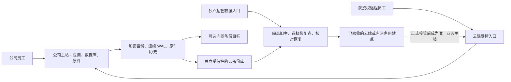

# 本地主用、受控云接入与灾备切换方案

日期：2026-10-23。状态：设计方案；日常远程接入和灾备接管仍需分别部署、演练后启用。

## 业务上的决定

正常情况下，公司服务器是唯一业务主站，公司员工继续走本地。出差、居家人员沿用 ADR-183 的受控云入口，初期保留最多五人的显式远程资格和 MFA，业务请求仍在公司完成，不把每条 SQL 拉到公网往返。

新增云端备份和灾时接管：本地硬件故障、断电或受攻击后，超级管理员可以在独立救援入口选择已验收的备用站点和恢复点，完成旧主隔离、恢复与核对，再开放云端办理。日常远程接入、备份目的地和业务运行位置是三个独立设置，不用一个“本地/云端”开关混在一起。

这扩展了 [ADR-183](../99-决策记录-ADR/ADR-183-本地业务服务与受控远程入口.md) 的“云仅做传输入口”范围；日常路径及其隔离/MFA规则保留。ADR-031 的旧 cloud App 逐条跨 WAN 查询路径不重新启用。云主站不会因为 `site=cloud` 自动成立，也不能通过伪装 `site=local` 绕过远程身份规则。

## 管理员实际怎样使用

设置中新增一个“运行与灾备”入口，复用现有服务器状态、服务器运维和 Uten 控件；不再造第二套服务器菜单。设计默认使用 `frontend-design`，保留现有主题、权限和布局约束。具体页面见[页面设计草案](../03-页面/运行与灾备设置-设计草案.md)。

| 区域 | 管理员能看到和操作什么 |
|---|---|
| 当前运行 | 当前主站、当前办理入口、数据代次、运行健康、正在进行的作业。普通员工只能看到必要连接提示，不能切主站。 |
| 远程使用 | 原有远程总开关、五人容量、获授权人员及 MFA 状态；继续走现有权限与再认证。 |
| 备份 | 可选目的地、最后一次目标验证、数据库与原件共同恢复时间、密钥版本覆盖、保留保护、演练结果。可同时选云端和合格内网目标。 |
| 备用站点 | 分别显示“已登记／可连接／备份已验证／恢复演练通过／可接管”；登记一个 IP 不等于具备接管能力。 |
| 恢复与切换 | “检查备用站点”“演练恢复”“准备接管”“查看作业”；真正开放办理前必须核验旧主隔离和数据核对。 |

本地服务完全失效时，用户仍能打开单独部署的救援入口；连接失败页和登录页提供同一入口的直达链接。救援身份预先登记，使用独立强认证和离线恢复材料，不依赖已经损坏的生产库、ERP JWT 或生产库中加密的 TOTP。

超级管理员是恢复操作者，不通过页面获得任意 shell/SQL。恢复作业固定站点、恢复点、制品 SHA、隔离证据和操作者；双击、并发操作和旧页面提交必须被服务端拒绝。普通管理员不能执行提升和回切。

## 日常和灾备的边界

| 状态 | 公司端 | 云端 | 员工行为 |
|---|---|---|---|
| 正常 | 唯一业务写主 | 受控远程入口、密文备份；备用业务进程不写业务 | 公司走本地，获授权远程人员走云入口。 |
| 公司外网中断 | 本地继续工作 | 暂停远程正式办理 | 不自动向云备份写单据，不自动重放提交。 |
| 主站故障、正在准备 | 旧主状态待核验；必要时停写 | 隔离环境恢复和核对 | 显示维护状态与真实恢复进度。 |
| 云端接管 | 已隔离，重启也不能恢复旧写主 | 唯一业务写主 | 重新登录；按已登记的灾备人员范围和 MFA 开放。 |
| 回切本地 | 从当前云主重新建立、核对新副本 | 回切前持续是唯一写主 | 维护窗口内再次受控切换，不合并两个可写库。 |

仅云端“连不到公司”不能证明公司已经停止写入。切 DNS、停止 Nginx 或一个 Spring 进程也不够；数据库、后台任务、本地用户和旧连接都必须被隔离。需要可独立核验的 BMC/受控电源、现场断电隔离，或可靠的主机/数据库停写机制。无法证实旧主已经失去写能力时，只允许恢复演练，不开放第二个可写主站。这与 PostgreSQL 的故障切换要求一致。[PostgreSQL 16 故障切换](https://www.postgresql.org/docs/16/warm-standby-failover.html)

首期采用人工受控接管，不实现自动双地选主。所有站点都必须核对当前主站代次，但代次记录不能替代可靠隔离。禁止自动回切；新主发生过业务写之后，不能用“取消”把旧站重新打开。

## 被攻击时怎样恢复

健康故障与疑似入侵走不同恢复路径。普通硬件故障可以使用最新完整恢复点；疑似入侵应先保全日志和受影响主机，选择攻击前可信恢复点，在干净环境恢复，不继续信任失陷主机的系统、同步副本或“成功”指针。

持续复制用于缩短恢复时间，历史不可变备份用于防误删和勒索，二者都需要。复制会把坏写入一起带走，不能因为有实时副本就删除历史。

恢复点必须成套包含数据库/连续 WAL/timeline、所有被引用原件的版本、PGP 当前与历史密钥、HMAC/AES-GCM 与 issuer/AAD 依赖、对应签名业务版本和恢复工具。展示的可恢复时间取数据库和原件共同水位，并核对密钥覆盖，不能只看数据库最后一条 WAL。

恢复后撤销旧业务会话、刷新凭据和 MFA 证明，复核备份后发生的离职、撤权及远程资格变化；不让历史备份复活旧权限。疑似泄露的登录/管理密钥按各自用途轮换，PGP/HMAC 的轮换按受控迁移执行，不能随机换一把使历史数据失效。AI 凭据、支付/通知和 outbox 等外部副作用在核对前保持停用或待核状态，不把已执行的付款或提交自动重放。

日常最多五人的远程资格不能自动扩大成全公司灾备资格。需要提前登记灾备员工和 MFA，或者独立于故障主机的受认证办公入口；不能用一个客户端可伪造的转发头放行所有人。

## 云上的资源与秘密怎样分开

现有云机器适合先承担低负载入口和加密备份接收。平时不保存备份解密私钥，不运行可写业务副本；真正接管时才经独立认证向干净恢复环境授予受限恢复能力和业务运行配置。

同一 ECS 的 Linux 用户或容器不能隔离已失陷的 root。若坚持原 ADR-183 中“云入口失陷不能取得业务”的信任边界，恢复执行应使用独立 ECS 或从可信镜像重建的干净环境，而不是在可能失陷的入口上直接解密。现有 ECS 可作为首期备用候选，但不能把同机进程隔离称为独立安全边界。

当前云主机为 4 vCPU/8 GiB、40 GiB 系统盘，检查时约 22 GiB 可用。它不能无验证地照搬公司应用约 6 GiB 上限再叠加 PostgreSQL、OCR 和行情。先演练核心业务所需的应用、数据库、附件和审计；OCR/行情等可选能力可有明确应急降级范围，不能静默失败后显示“完全恢复”。全部后台任务也只能在当前主站启动。

现有行情签名运行包要求 Ubuntu 24.04/x86_64/CPython 3.12，现云主机为 Alibaba Cloud Linux 4。不能直接复制 venv 或改系统标识绕过校验。应使用受支持的独立恢复环境；若评估 Ubuntu 24.04 容器，必须验证原生库、资源、持久卷、隔离和完整签名包，再登记为可接管站点。此方案没有授权购买新实例或重装当前云系统。

## 备份存放选择

| 目标 | 建议用途 | 当前状态 |
|---|---|---|
| 独立云备份库 | 长期加密历史、不可变保留、灾时恢复来源 | 尚需独立 OSS bucket、最小权限、锁定保护和恢复演练；不复用发布桶的写删身份。 |
| 当前 ECS 私有目录 | 一份已经核验的密文副本、恢复准备缓存 | 本轮已完成单次复制与摘要验证；不是不可变备份，也尚未配置持续接收。 |
| 另一台公司服务器 | 可选第二份内网密文副本；升级并演练后再考虑业务备用 | 当前网络未连通，Windows Server 2008 R2 已结束支持；暂不能登记为生产接管站点。 |
| 管理电脑/离线保管 | 加密副本及独立恢复材料的受控保管 | 本轮有密文和受保护私钥，但同一电脑上的材料不等于两处离线托管。 |

独立云备份库使用唯一命名对象、精确版本清单、目标验证收据和锁定的不可变保留。生产上传身份不能删除历史、缩短保留、改生命周期或自行解密，保留管理与恢复身份分开。WORM 锁定是不可逆的保留约束，必须先做容量、费用和演练检查，再锁正式策略；本轮没有创建或锁定新的收费资源。[OSS BucketWorm](https://www.alibabacloud.com/help/en/oss/user-guide/oss-retention-policies)

不把当前对象目录简单做实时镜像当作防勒索备份。OSS CRR 的删除标记可能传播，即使某些规则不复制特定版本删除也不能一概承诺“所有删除都隔离”；如果使用复制，必须针对实际规则测试、按清单固定版本恢复，并用不可变历史保护旧版本。首期优先独立发布固定的加密恢复集合。[OSS CRR 行为](https://www.alibabacloud.com/help/en/oss/user-guide/cross-region-replication-overview/)

恢复目标沿用既有设计候选 RPO 不超过十五分钟、RTO 四小时；目前没有验收达标。每天两次逻辑成套备份及本次一份密文只能证明已有一个可核验集合。还需要连续 WAL、原件历史确认和完整故障演练，再展示真实共同恢复水位。

## 实施顺序

1. **安全与备份基础**：完成本地主机整改，云旧服务停用，云密文副本；再配置持续异机接收、不可变历史、离线密钥托管和完整隔离恢复。
2. **原有五人远程路径**：发布并按 ADR-183 接通受控入口、机器隧道与 MFA；验证内网照常、撤权即时生效、断网不双写，不改正常主库位置。
3. **灾备准备**：登记候选运行环境、恢复点目录、独立超管身份和可靠隔离方式；设置先允许检查和演练，未达到条件不能点真实接管。
4. **受控接管上线**：演练本地断电、单纯断网、被攻击回溯、旧主重启、缺件、满盘和回切；逐项通过后才向超管开放实际接管作业。

每阶段分别记录源码、本地测试、云端部署、实机恢复和员工 UAT，不能用开关、上传成功或一次健康检查替代后续验收。

## 本轮已经做了什么

- 本地主机安全包更新并经用户批准重启，已运行新内核；业务清空网关、应用配置和数据库权限均禁用。新客户端入口和新启动守卫仍是待发布源码。
- OCR 四个风险依赖已在隔离候选验证后受控激活，真实 PNG/JPEG 模型推理通过；没有替换业务 JAR。
- 云上旧 JustPlay/OpenIM 等八个运行容器已停止，九个旧容器的自动重启均关闭；旧 Nginx 入口停用。没有删除镜像、容器、持久卷或原业务文件。云内存从约 5.2 GiB 降为约 0.8 GiB，实际公开监听只剩 SSH。
- 42,300,069 字节 OpenPGP 密文包已放入云端 root-only 私有目录并验证 SHA-256；解密私钥未上传。没有恢复云数据库、开放远程办理、配置持续云备份或启用云端接管。

详细安全与备份证据见[本轮核查记录](../99-项目治理/2026-10-23-上线前安全核查与业务清空下架.md)，设计边界见[独立灾备审查](../99-项目治理/2026-10-23-灾备切换架构审查.md)。
