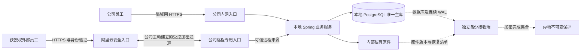

# 外网访问与混合部署研究方案

> 后续：用户已授权完成5人接入代码和文档，并要求云入口失陷不能成为公司内网跳板。
> 本文保留研究过程；实际实现与安全边界以[ADR-183](../99-决策记录-ADR/ADR-183-本地业务服务与受控远程入口.md)
> 和[新接入部署目录](../../deploy/remote-access/)为准：云端透传员工TLS、外层机器mTLS、公司侧端口隔离，默认关闭。

日期：2026-10-17。状态：历史研究稿；下文“不改代码”等描述仅指最初研究阶段。后续代码交付见[实现与验证记录](2026-10-17-五人远程接入实现与验证.md)，实际采购和现场接入仍待执行。

建议保留公司本地唯一主库，并把 Spring 业务服务继续放在主库旁边；阿里云承担安全 HTTPS 入口、加密连接与独立监测。先解决指定员工远程办公，再独立建设异地恢复能力。这样能保留公司断外网时的内部办公能力，也避免每条 SQL 都跨公网往返。

没有一种两地架构能无条件保证“公司完全断网仍正常写、外部同时正常写、两边永远没有库存财务冲突、零丢失”。本方案优先保证账实一致，以备用网络减少中断，以明确的草稿和恢复流程处理不可避免的中断。

## 1. 研究基线与适用条件

本方案核对了当前仓库代码、旧云地架构、部署手册、附件设计、系统设置，以及 Microsoft、Cloudflare、Tailscale、阿里云和 PostgreSQL 官方资料。仓库 HEAD 为 `7161a08ceb72b6d6c03b6b6a3e6e83dad6b7133c`，工作区另有并行未提交修改；源码能力不等于该提交已安装到服务器。

服务器存储、备份和已执行安全控制引用 **2026-10-13 验收快照**。用户补充要求自行核查网络和UPS后，本轮于 2026-10-17 16:28（America/Denver，22:28 UTC）通过既有SSH配置和严格主机密钥校验做了限定只读检查，结果列于下文；未修改远程配置、安装软件或运行占满带宽的测速。实时版本、带宽与完整网络拓扑仍须在实施前复核。

用户本轮已明确：**当前外网最多5人，偶尔海外使用；断网处理可按合理方案选择，没有严格持续在线约束。** 因此一期采用少量人员受控接入，断网暂停外部正式办理；无需为这5人立即建设双云入口、跨地域自动接管或第二套在线数据库。主要工作仍在公司，云地域优先大陆，海外体验在实际使用地验证后再决定是否优化。

### 已有能力与真实缺口

| 项目 | 核对结果 | 本方案处理 |
|---|---|---|
| 历史云地方案 | ADR-031：本地唯一主库，云端 App 正常读写仍连接本地主库，云库为异步副本 | 保留单主原则，建议替换跨公网访问数据库的业务路径 |
| 旧云部署手册 | 已随 ADR-060 退役，真实 ECS/VPN/切换回切未验收 | 不能填地址后照抄执行；后续按现役签名发布链重写 |
| 指定员工外网授权 | `remote_access` 默认关闭；仅超管可改；授权变化撤销会话并审计 | 复用用户授权和审计，修正入口识别方式 |
| 内外网判断 | 当前主要依赖 `deployment.site=local/cloud`，本地另有来源 CIDR 门禁 | 云代理接本地后端需要新的可信入口上下文 |
| 原生/Web 入口 | 原生使用构建时批准的 HTTPS 端点；Web 同源 `/api` | 保留；Web 优先内部/外部 DNS 分别解析 |
| 本机草稿 | 原生文件与 Web IndexedDB 已有存储实现；另有服务端业务草稿 | 按页面验证，不能笼统宣称全系统离线可用 |
| 写入结果确认 | 部分生产业务已有命令回执；设备操作回执并不等于事务去重 | 对远程开放的写操作逐类补齐结果确认 |
| 身份验证 | 员工密码规则目前仅要求非空；敏感操作再输密码不是 MFA | 外网增加真正的MFA/通行密钥验证，受管设备准入作为附加控制 |
| 附件 | 已采用公司内部私有存储，ADR-074 取代旧 OSS 必选 | 一期保留原件位置；外网下载继续经业务权限检查 |
| 系统设置 | 已有系统策略、平台设置、权限管理和服务器状态 | 扩充现有入口，不另做一套平行控制台 |

主要仓库证据：[ADR-031](../99-决策记录-ADR/ADR-031-本地云端单主库部署架构.md)、[退役云手册](../../deploy/cloud/README-cloud.md)、[RemoteAccessPolicy](../../server/src/main/java/com/uten/imp/security/RemoteAccessPolicy.java)、[LocalNetworkGuardFilter](../../server/src/main/java/com/uten/imp/security/LocalNetworkGuardFilter.java)、[CloudRoutingDataSource](../../server/src/main/java/com/uten/imp/config/cloud/CloudRoutingDataSource.java)、[ADR-074](../99-决策记录-ADR/ADR-074-公司内部附件存储与原件保留.md)。

### 服务器快照意味着什么

2026-10-13 记录：两块 2 TB SMR 机械盘做 RAID1，承载主库和一组本地备份；一块 512 GB NVMe 承载系统、附件和另一组本地备份；内存约 31 GiB。逻辑卷分开不等于物理风险分开。同一主机的两组备份不能抵御整机损毁、失窃或共同管理员被攻破。

当时 RAID 正常，但有一块机械盘存在历史 ATA 错误，NVMe 记录过非正常关机；UPS保障时长未得到证实。不能为了提速直接把主库搬到单块消费级 NVMe。应先核对供电、冗余、磁盘延迟及恢复能力，再考虑有断电保护的冗余事务盘。

本地备份已改为十四天；第二台内部服务器尚未接入。此前选定的“最多丢十五分钟数据、四小时内恢复”仍是目标，成套数据库与原件备份每天两次，不能据此证明十五分钟整套系统 RPO。一次 192.5 秒的逻辑恢复不等于完整灾难恢复已达标。[2026-10-13 验收记录](2026-10-13-内网服务器安全与备份阶段验收.md)

2026-10-17 本轮只读检查还确认：

| 检查 | 实际结果 | 能得出的结论 |
|---|---|---|
| UPS监控软件与服务 | 未安装 NUT/nut-client/nut-server/apcupsd，对应服务不活动 | 主机未接入这些常见UPS监控及自动关机链，不能认定已有受控断电保护 |
| 主机电源设备与USB | 未发现 power_supply 项或匹配UPS厂商/设备名的USB设备 | 不能据此断言现场没有物理UPS，网络管理型或未接通讯线的UPS仍可能存在 |
| 主机网卡与路由 | 一块物理网卡 eno1，连接速率1000 Mbps；一个IPv4默认路由 | 这是公司局域网连接，**不是1000 Mbps互联网带宽**；路由器后有几条WAN无法由此推断 |
| 核心服务 | 应用、Nginx、PostgreSQL均为active | 确认进程服务活动，不替代业务UAT或吞吐测试 |

仓库资产记录也没有可靠的运营商/双WAN清单。宽带数量、实际公网速率、UPS型号与续航目前仍未证实；后续需读取路由器WAN状态或设备资产信息，并核对UPS管理接口。若没有第二线路，当前5人场景可以先接受外网中断，备线作为按收益增购项；UPS与安全关机则关系主库和文件完整性，应优先补证和建设。

## 2. 数据库放哪里

| 方案 | 内部办公 | 远程办公 | 公司全断外网 | 运维与一致性 | 判断 |
|---|---|---|---|---|---|
| 本地 App + 本地数据库，云端安全入口 | 局域网直达 | 一个业务接口经云回公司 | 内部可继续，外部暂停或走备线 | 一套权威业务数据 | **本期推荐** |
| 云端 App + 云端数据库 | 每人都依赖公司外网 | 不依赖公司机房 | 公司内部也无法正常办理 | 云可用性好坏取决于实际HA配置 | 若未来多数人在外、愿接受内部依赖公网，可重新评估 |
| 云端 App + 本地数据库 | 原本内网路径可保留 | 多轮数据库往返跨网 | 云端业务受阻 | 超时、事务和连接池更复杂 | 不作为新方案日常主路径 |
| 两地各有可写库，恢复后自动合并 | 分区期间能各写 | 分区期间能各写 | 可产生两套业务事实 | 库存、金额、审批、单号冲突无法通用合并 | 不采用 |

本地与云端没有先验的绝对安全高低。当前本地方案的优势是既有流程、局域网性能与断外网自治；前提是补足供电、备份和维护能力。如果改为云主，应用也应与数据库同地域低延迟部署，不能只迁数据库而保留本地应用逐条跨网查询。

## 3. 推荐的日常访问路径



云上负责 TLS、安全准入、限流、转发和必要的静态资源；业务事务、权限核验、定时任务、扫描以及原件处理保留在公司。云入口不需要数据库账号，不维护第二套库存，也不缓存待执行的业务写命令。

公司到云的连接由内部连接器主动建立，适配动态公网地址和 NAT；不向公网开放 PostgreSQL 或 Java 原始端口。数据通道仅能到达规定的 ERP 入口，不能成为通往整个公司网络的跳板。参考机制可见 [Microsoft Entra 应用代理](https://learn.microsoft.com/en-us/entra/identity/app-proxy/overview-what-is-app-proxy)与[阿里云 SASE 连接器](https://help.aliyun.com/zh/sase/user-guide/using-the-sase-connector)。

### 接入产品比较

| 路线 | 适合情况 | 需要验证的限制 | 本项目选择 |
|---|---|---|---|
| 阿里云 ECS + 加密隧道 + HTTPS 代理 | 需要兼容现有 Web、Windows、手机端并精确控制行为 | 自行维护补丁、证书、隧道、认证与故障恢复 | 按当前购买意向作为实施基线 |
| 阿里云 SASE | 希望托管人员/设备准入，减少自建网络运维 | 浏览器无客户端不等于原生 App 兼容；验证认证、长连接、附件、授权撤销及报价 | 同期做一次兼容性小试；通过且总成本合适可替换自建入口 |
| Tailscale | 少量受管设备、管理员维护、快速验证 | 客户端安装、设备撤销、路由和中继表现；不能开放整个 LAN | 可做受控运维/试点，不直接等同免客户端正式业务入口 |
| Microsoft Entra Application Proxy | 已有 Microsoft 企业身份体系 | 连接器环境、许可、租户与大陆可用性 | 学习其出站连接与多连接器模式，不为本 ERP 另引入整套体系 |
| Cloudflare Tunnel + Access | 已有 Cloudflare 体系，或海外用户占比大 | 普通服务与 China Network 企业扩展的大陆交付、网络、条款不同 | 保留备选，不凭普通免费 Tunnel 承诺大陆生产稳定性 |

阿里云 SASE 的[办公应用配置](https://help.aliyun.com/zh/sase/user-guide/application-management)区分 App 访问和浏览器访问，浏览器方式不提供同等终端管控。Tailscale 当前[连接类型](https://tailscale.com/docs/reference/connection-types)包括直连、Peer Relay 和 DERP，实际路径必须观测。Cloudflare 已有 [China Network](https://developers.cloudflare.com/china-network/)与[Global Acceleration](https://developers.cloudflare.com/china-network/concepts/global-acceleration/)，不能简单归为“大陆不支持”，也不能把企业扩展能力套到普通套餐。

自建通道优先评估受维护的 WireGuard 或路由器 IPsec 站点连接，不自创加密协议。NAT保活可参考 [WireGuard 官方说明](https://www.wireguard.com/quickstart/)；双线路路由、MTU、重连、密钥轮换和禁 UDP 网络须在试点验证。是否改用托管 VPN/SAG，由现有路由器能力、双线路与维护成本决定。[阿里云 VPN 网关](https://help.aliyun.com/zh/vpn/product-overview/what-is-vpn-gateway)、[SAG 多链路能力](https://help.aliyun.com/zh/sag/product-overview/functions-and-features)

### 一套服务与两种可信入口

建议长期保持一套本地业务服务，分别接收办公入口和远程入口的可信安全上下文。现有 `site=cloud` 应逐步拆成“部署位置”和“请求来自何种入口”，后者决定是否执行远程授权。

具体信任链：远程入口独立监听，只接受云网关的受控隧道及 mTLS 身份；内网入口只接受精确办公范围，并禁止隧道访问这个LAN入口。边界代理清除客户端自带来源头，以经过验证的连接身份生成来源；业务服务只信任固定本机代理/专用连接器的这一信息。所有入口的上下文缺失、冲突或不受信均归为UNKNOWN并拒绝，不能默认成local。原始客户端 IP 用于审计和风控，不能单独授予办公身份。若采用签名上下文，还须绑定请求、短时有效期和抗重放信息。

不能把云网关 IP 加入办公白名单后原样转发到现有 local 应用：保留外部 IP 会被现有本地门禁拦截，伪装成办公来源则可能绕过 `remote_access`。登录、刷新、每个已认证请求、下载、长连接重连都必须走同一可信来源规则。

短期备选是在公司运行专用远程 App 实例并同地连接主库；这不是直接启用旧 cloud profile。必须分离双数据源假设，核对定时任务、事件派发、扫描与清理是否重复运行，并核算连接池和发布兼容。因此不作为默认捷径。

### 域名与内部自治

Web 优先使用同一个正式业务域名：公司 DNS 返回本地入口，公网 DNS 返回云入口。静态资源和 `/api` 同源，避免浏览器跨域探测内网。两端须有有效证书，公司 DNS、DHCP、交换机和证书信任不能依赖公网在线才工作。

另保留经批准的内网入口用于 DNS 故障排查；浏览器安全 DNS、VPN DNS 和缓存可能使办公室设备走到云上，必须实测，走云仍按远程权限判定，不能因员工声称身处办公室而放宽。域名、证书续期和 DNS 管理身份独立于普通业务账号。

原生端继续使用受信端点与自动模式，不开放任意地址输入。切换连接只影响后续请求；进行中的写入先核对结果。探针需要区分“入口在线”“本地业务可用”“账号可访问”，不能以 HTTP 200 或 TCP 通就宣称可以办理。

若现用内网域名要迁到新正式域名，这是独立的入口与本机数据迁移：并行保留旧入口，在原origin读取本机草稿/偏好，再经用户确认和数据域核验迁入新入口；不传递URL中的登录令牌，不以清浏览器数据解决切换。域名和证书轮换不应丢失已安装客户端的信任配置、个人偏好与待确认命令。

## 4. 速度怎样保障

决定速度的主要因素是前端串行接口数、公司到云的往返时延、公司上行、附件体积、业务查询/锁等待和磁盘，而不是只看云服务器 CPU。

**示意计算，并非实测：**若云端业务服务的一次操作需要二十轮串行数据库交互，云地 RTT 为 40 ms，仅这部分就可能增加约 800 ms。改成请求先到本地业务服务后，SQL 往返发生在公司内部；跨网成本主要是业务 HTTP 往返。一个页面若串行调用五个接口，仍会支付五段等待，不能保证全部页面只跨网一次。

附件另算：公司上行若为 20 Mbps，一个 10 MB 文件仅理想传输就约需 4 秒，多人同时下载还会共享带宽；实际还受协议和链路影响。员工上传文件到公司则主要占公司下行；云出口既承担发给员工的数据，也可能承担经公网隧道发给公司的上传数据。WAL和异地备份不能抢满白天上行。

实施时先测两三个候选阿里云地域，选择公司与主要员工实际表现较好的大陆地域。每条主/备线路分别测试，至少覆盖一个完整工作周的高峰、低峰和运营商差异。

| 测试内容 | 记录指标 | 调整方向 |
|---|---|---|
| 登录、工作台、搜索、列表及详情 | 端到端 p50/p95/p99、串行 API 数、响应大小 | 合并必要请求、分页、索引与权限查询优化 |
| 保存、审核、入出库、付款等 | 提交确认耗时、锁等待、错误率、结果未知次数 | 缩短事务、命令回执、并发保护 |
| 报表、导出、批量操作 | 任务耗时、峰值内存、对普通请求影响 | 已支持任务模型的异步化；未支持的单独改造 |
| 原件上传、下载、预览 | 1/10/50 MB 样本吞吐、恢复行为、扫描耗时 | 带宽、流式传输、可验证的分段/续传能力 |
| 网络与硬盘 | RTT、抖动、丢包、有效上行、磁盘延迟 | 线路、MTU、流量调度、事务盘 |

普通列表 p95 ≤ 1 秒、简单保存确认 p95 ≤ 2 秒可作为初始体验目标；复杂物料分析和报表另定预算。这些是试点目标，不是当前达标或 SLA。按预计外部并发 N、2N 及同时备份/下载压测，再确定云规格。

静态 Web 资源可在云端缓存，API、鉴权响应和私有附件默认不得进入公共缓存。附件如需以后用 OSS 加速，须另做私有对象、短时访问、撤权时效及原件归属设计；本期不因外网接入自动改变存储。

## 5. 断网时怎么操作

产品必须区分：未发送、已发送但结果未知、服务器已确认成功、服务器已确认失败。网络超时只能说明没收到确定结果，不能推断数据库没执行。

| 业务/状态 | 离线允许行为 | 恢复后的处理 |
|---|---|---|
| 已支持本机草稿的填表 | 保留输入，提示“仅保存在本机，尚未提交” | 重新取得账号权限、最新资料和版本，再由本人确认提交 |
| 服务端业务草稿 | 不能继续声称已保存到服务器 | 查询最新服务端版本，处理冲突 |
| 已打开的历史列表/详情 | 可按页面能力保留最后画面，显著标明时间与过期 | 刷新后才能据此做下一步业务 |
| 库存扣减、出入库、付款、核销、审批、反审批 | 禁止离线正式办理及自动排队补交 | 在线重新校验余额、状态、来源、权限和版本 |
| 写入已发出但响应丢失 | 显示“正在确认结果”，保留原命令身份 | 查询持久命令回执；查不到仍是UNKNOWN，不能换新命令ID重做 |
| 附件上传中断 | 原件未完整接收/校验/扫描前不标为可用 | 查询上传尝试；已实现的上传协议按能力恢复，不能假称全量支持断点续传 |
| 外部 AI、短信等云依赖 | 相应功能显示暂不可用 | 单独恢复，不阻断无需它们的内部业务 |

当前本机草稿 namespace 含服务器 URL，内外网换地址可能使同一人的草稿暂时看不见。后续应引入受信、稳定的数据域身份，并绑定公司/环境、用户、代操作身份、业务重置代次及权限边界；仅在已验证两个端点属于同一数据域后迁移兼容，不能凭公司显示名称合并。Web 不同域名的 IndexedDB 仍受浏览器同源限制，不能只改键名就跨域共享。端点与账号切换须继续阻止旧响应覆盖新页面。[草稿存储](../../lib/shared/drafts/form_draft_store.dart)

本机草稿还需核对哪些页面已接入、敏感字段、设备共享、落盘加密、保留期和清理策略；现有 JSON/IndexedDB 存储不能直接宣称全部已加密。撤权不能让一台断网设备立刻忘掉已显示的信息，因而外网应限制敏感离线副本、下载与设备资格。冷启动网页及所有历史页面并无普遍离线可用保证。

命令回执扩展采用“数据域+操作者+命令ID”，绑定请求摘要并与业务事务原子提交；同一ID不同内容拒绝执行，查询仍须核验权限。保存幂等身份必须先于发送。以现有[生产日报命令回执](../../server/src/main/java/com/uten/imp/features/production/dailyreport/ProductionDailyReportService.java)为参考逐类推广，不能把[设备 HTTP 回执](../../lib/core/network/interceptors/device_audit_interceptor.dart)当作服务端去重。所有代理、客户端和故障切换层均禁止对结果未知的非幂等写自动重试。

查不到回执不证明未提交，可能是事务仍在执行或旧链路未记录；保持未决状态，直到取得权威结果。只有已实现并验收同键去重的具体业务，才可按其协议、保留原键与原载荷由用户明确重试；禁止自动生成新键绕过未决状态。

## 6. 故障处置矩阵

| 故障 | 公司内部 | 外部员工 | 处理和恢复边界 |
|---|---|---|---|
| 单个员工网络断开 | 其他人正常 | 该员工暂停正式提交 | 保留可用草稿，重连后确认未决命令 |
| 公司主宽带中断 | 本地业务继续 | 备线接管前短暂中断 | 独立运营商备线/合适的蜂窝备线；重新建链，不能重放写 |
| 公司所有外网中断 | 本地服务和 LAN 健康时继续 | 正式业务暂停 | 不因断链提升云备库；恢复后追平复制/备份 |
| 单条隧道或连接器故障 | 继续 | 已验收备用通道接管 | 两个进程共一台机不能抵御整机故障 |
| 单台云入口故障 | 继续 | 双节点方案切另一节点 | 单 ECS 方案只能维修/重建；它不是 HA |
| 云可用区故障 | 继续 | 跨区入口与独立通道健康时可继续 | 同地域跨可用区并不能覆盖整个地域故障 |
| 云地域或身份服务故障 | 本地认证不依赖它时继续 | 暂停或已验收备用服务接管 | 第一阶段可接受修复；需要跨地域时另立目标 |
| DNS错误、证书过期 | 可能影响本地入口 | 可能整体不可用 | 本地DNS冗余、到期告警、受控备用入口；禁止关闭TLS验证 |
| 公司应用故障、DB健康 | 暂停 | 暂停 | 本地受控重启/应用恢复，不因此提升云数据库 |
| 数据库故障或磁盘满 | 暂停相关业务 | 同样暂停 | 先保全数据、检查WAL/磁盘，再恢复；禁止手工删WAL救急 |
| 单块阵列盘故障 | 视阵列/IO状态运行或维护 | 同左 | 告警并更换；RAID不替代备份 |
| 公司断电 | UPS续航内按负载策略工作 | 同左或网络先中断 | UPS应覆盖路由器、交换机、光猫；耗尽前有序停机 |
| 公司整机/机房损毁 | 暂停到恢复 | 暂停到恢复 | 独立恢复环境及异地备份；人工受控灾备切换 |
| 只发生云地网络分区 | 本地主库可能继续写 | 暂停或备线恢复 | 不自动产生第二个写主库 |
| 请求提交后响应丢失 | 该操作结果待确认 | 同左 | 依据命令回执查结果，不靠重复点击猜测 |
| 账号被撤销/设备失窃 | 按账号与设备策略处理 | 新请求拒绝，旧会话按边界终止 | 后端、入口两层撤销；长连接须能失效/重验 |
| 外网扫描、爆破或大量下载 | 应优先保障内部容量 | 限流或临时关闭外网 | 外网单独并发预算；管理通道不随业务公开 |
| 误删、勒索、逻辑错误 | 隔离相关业务 | 同步限制 | 热备也会复制错误；从不可变历史点恢复并对账 |
| WAL或原件备份积压 | 优先保住本地服务 | 可限制大流量任务 | 阈值告警、磁盘预算；复制槽失效后受控重建 |
| 发版不兼容/静态资源错配 | 视影响恢复兼容版本 | 同左 | Web/API兼容检查、保留原配置和草稿；迁移不能随代码盲目回滚 |

网络切换不等于数据主库切换。故障恢复顺序为“链路/服务恢复 → 最新身份与权限 → 命令结果确认 → 页面刷新 → 人工继续业务”。不得把自动连通当作未决操作已经失败。

## 7. 稳定性与恢复分层建设

### 第一层 保障公司内部继续工作

核实 UPS、独立 DNS、交换机与路由器供电、磁盘健康和容量。附件、扫描、本地账号验证不能在断外网时反向调用云服务才允许继续。若外部 MFA 使用云身份提供商，只约束远程通道；本地原有授权不应因身份云故障整体停摆。

两条宽带应尽量不同运营商和入户路径；同一光纤上的两个拨号或两条隧道不是独立备份。具备双 WAN 自动切换的路由器负责线路恢复，应用仍按结果未知处理断开的请求。

### 第二层 保障远程入口

本次最多5人且可接受中断，**一期推荐一台ECS安全入口或一个合适的托管接入服务**，加自动进程恢复、配置备份、外部探测和明确修复流程；单节点故障期间外网暂停，内部继续。双可用区入口不是一期采购门槛。将来业务对远程停机更敏感，再增加两个可用区的入口节点、独立通道和具备健康检查的负载均衡；无需同时运行两份业务数据库。

健康检查要包含到公司业务入口的受限只读检查，而非仅云 Nginx 存活。负载均衡摘除坏入口，不自动重试已发出的写。两台入口若共用单一公司连接器、路由器或 ISP，仍有共同故障点。多连接器的成熟参考见 [Entra 高可用设计](https://learn.microsoft.com/en-us/entra/identity/app-proxy/application-proxy-high-availability-load-balancing)。

### 第三层 数据和原件的独立保护

延续现行本地十四天快恢复层，接入第二台内部服务器作为独立接收和恢复环境，再配置异地/云上加密不可变副本。第二台机若仍在同一机房、同一电源下，不能代替异地灾备。

数据保护沿用此前确定的 RPO ≤ 15 分钟、RTO ≤ 4 小时作为独立建设目标，不与本轮5人远程入口的短时中断要求混为一谈。必须分别测数据库、所有私有原件及整套系统。整套系统可恢复时点受数据库 WAL 和原件版本共同水位约束，还要验证每条恢复引用确有对应原件，不能简单取两个时间戳就宣布一致。恢复清单还包括角色权限、运行配置、匹配程序版本及历史密钥版本引用；历史钥匙独立加密托管、独立授权取回，不与备份密文放在同一包或同一可读权限域内。演练必须证明历史密文可解密。

接收端主动拉取或使用仅能追加受限对象的身份；生产机不持有删除历史备份的权限。公网入口无备份读取、写入、列举、解密或保留策略修改权限；备份接收服务不与公网入口共宿主，接收、清理、恢复和密钥托管分别授权。完成集合与清单用独立不可变层保护，不把活动 pgBackRest 仓的可变元数据直接放进禁止覆盖的目录。[既有异机备份合同](../../deploy/postgres/backup/OFFSITE_INTERNAL_SERVER.zh-CN.md)

云端候选为 OSS 私有加密备份保护，WORM锁定后保护期内不可删除或缩短保留期，必须先在隔离测试桶验证容量、恢复、元数据更新和清理兼容；不与公开业务网关共用高权限身份。[OSS 保留策略](https://help.aliyun.com/zh/oss/user-guide/oss-retention-policies)

三十五天连续恢复窗口、十二个周点、十二个月点是既有候选，不自动变成本轮承诺；按数据增长、发现错误的时间和存储费用定案。云副本、磁盘快照、RAID均不能代替独立的历史恢复点。异地保护超过十五分钟水位时必须显示“恢复目标暂不满足”，不能继续全绿。

### 第四层 可选云端接管

先完成独立恢复演练，再按需要增加异步云备库和备用业务运行环境。正常业务仍连本地权威服务，云副本不承担需要最新库存、权限和写后立即读取的日常查询。异步复制不让公司每次提交等待公网，但永久丢失主库时可能丢尚未复制的数据。

灾备接管流程：确认故障性质 → 可靠隔离旧主 → 确认并记录最后共同恢复点及可能缺失 → 恢复数据库、原件、密钥、权限和程序 → 库存财务关键对账 → 人工批准唯一新主 → 切入口和重验会话。隔离必须在数据库、主机或存储层可验证地阻断写入，并持久禁止旧主自动重启为主；仅关闭HTTP入口不足以阻止后台任务和已有数据库会话。拿不到隔离证据则停止接管。旧主恢复后不得直接重新上线写入，应先重建为新主的副本；回切需计划窗口与再次隔离。

PostgreSQL自身不提供完整的故障判断和隔离旧主系统；仅发现网络不通就自动提升会有双主风险。[PostgreSQL 16 故障切换](https://www.postgresql.org/docs/16/warm-standby-failover.html)

若业务硬要求公司与外部分区期间双方都能继续正式办理，就需要重新定义哪些业务可以分区独立处理、预分配额度/库存和后续核对流程，或改变唯一主站的位置；不能通过增加一个“自动同步”开关满足。

## 8. 部分员工开放外网的安全规则

远程访问资格和业务权限分开：能从外网进入，不代表多看客户、工资、成本或多做审批。所有数据范围、审批限制、数量状态与来源校验保持服务器权威。

1. 默认所有员工关闭外网；由超管明确授予。建议增加到期时间、授权理由、可用设备和最后远程活动记录，支持批量查看与撤销，但不默认给整个部门永久开放。
2. 外网人员启用真正 MFA：优先评估带用户验证的通行密钥/安全密钥或密码加 TOTP，配套丢失恢复与管理员身份核验；现有再次输入密码只属于再认证。受管设备是附加控制，不单独代替强身份。若采用 SASE 身份认证，须验证不可变身份与 ERP 员工UUID/会话绑定，不能接受任意用户名头。内网签发的旧JWT转到外网，也必须补充远程强认证；其验证结果在每次远程请求中与当前会话、策略版本和有效期绑定，避免借用他人入口登录态。
3. 当前密码仅非空的规则继续作为既有事实；本方案不暗中修改全员口令规则。正式外网开放以独立强身份措施为门槛，不能只靠一个弱密码和授权布尔值。
4. 登录、刷新与业务调用均核验当前远程资格；撤权同时处理入口会话、ERP会话、长连接和附件短时链接的有效期。不能宣称撤权后已下载文件能被远程收回。
5. 公网只发布业务必要入口。主机SSH、数据库、任意诊断、测试清库、更新控制使用单独管理通道；高权限系统配置默认要求受管设备和更强验证。
6. 外网请求有独立并发、导出、下载与大文件预算；共享运营商 NAT 下按账号/设备限流为主，IP只承担粗粒度防洪，避免一个人使全公司被封。
7. 网关故障不缓存业务写载荷；日志不记录口令、令牌、敏感请求正文或完整附件，私有响应禁公共缓存，云临时上传缓冲须有权限、容量和清理限制。
8. 云端和另一台服务器承担独立可用性监测，才能在主机整体停机时发出通知；渠道、联系人和升级规则在实施时登记。

现有员工采用单设备会话，新登录会撤销其他会话；外出手机登录可能使办公室电脑退出。第一版保留现行规则，在试点说明此体验；若确需多设备，再单独设计设备列表、会话上限与逐设备撤销，不因外网接入暗改账号合同。

## 9. 系统设置怎样做到方便而清楚

沿现有“系统管理 → 系统设置”新增“外网访问与连接”入口，复用平台设置的连接核验和服务器状态能力。普通员工设置只展示当前连接方式、网络状态、恢复自动选择和诊断编号。只有超管可修改全局策略；已有 `server_status:view` 可按范围查看脱敏运行状态。

建议页面结构如下，示例文字不代表当前运行状态：

```text
外网访问与连接
当前状态：待接入 / 运行正常 / 部分中断 / 已关闭
本机连接：公司内网       业务数据：公司主服务器

访问范围
  开放外网访问           [开关]
  已授权人员             查看与管理 >
  远程身份验证           已接入 / 待完成

连接与诊断
  外网入口               受信域名、证书到期日期
  公司连接               主线 / 备线、延迟、最近检查时间
  服务能力               登录 / 业务 / 附件分别显示
  [检查连接] [导出脱敏诊断]

数据保护
  当前唯一写入站点        公司
  本地备份 / 异地保护     最近成功及共同恢复点
  恢复演练               日期、结果、未完成项
  告警与通知             设置 >

高级维护  [默认收起]
  配置变更记录、版本、连接器健康、维护计划
```

| 功能 | 在业务设置中怎么做 | 生效与安全边界 |
|---|---|---|
| 外网总开关 | 清楚显示影响，支持临时关闭 | 应用立即拒绝新的远程业务，不禁用内部账户；入口配置状态另显示，不误说物理链路已断 |
| 员工外网资格 | 复用权限管理人员入口，增加有效期与设备信息 | 授权变化沿用全会话撤销与审计，内部需重新登录；保留本地管理恢复入口 |
| 连接诊断 | 查看各跳是否通、业务/附件能力、脱敏编号 | 不能输入任意URL进行探测，避免成为内网扫描工具 |
| 域名/证书/连接器 | 显示登记值、到期及已应用版本；向导可提交变更计划 | 凭据只写不回显，由专用运维执行器验证，不让Java以root改配置 |
| 告警阈值 | 超管调安全范围内阈值和联系人 | 验证通知通道；失败或数据过期不能沿用绿色 |
| 灾备/恢复 | 显示可恢复点、演练记录和维护申请 | 不放“自动切主库”普通开关；受控维护流程另行处理 |

首次向导建议为：登记域名 → 核验 DNS/证书 → 注册一次性连接器身份 → 连通性预检 → 验证一个受控测试账号 → 显示配置差异与影响 → 生效 → 外部探测回读。一次性身份短时过期，不能在普通表单粘贴全权限云 AK/SK。

**针对5人的第一版**，先交付总开关、人员授权/到期、强认证状态、连接检查和告警；域名、证书及连接器先由维护者一次安装，页面只读显示状态。完整安装向导与自动化变更可留到第二阶段，避免为了少量接入先建设一套云资源管理平台。

把“计划配置、执行中、已应用、验证失败、已回退”分开展示。后端记录期望版本和实际版本；管理员并发修改要检查版本，网络配置变更断开自身时有自动回退和本地恢复入口。自动回退只作用于明确登记的网络配置事务；不得恢复已被管理员关闭的外网总开关、撤销的账号资格或设备权限，过期或已撤销的证书与不合规旧配置也不能恢复。全局配置、主机配置和云资源配置不可能天然单个数据库事务完成，须设计分步骤回执与补偿，不能用一次保存成功冒充全部生效。

视觉采用已读 `frontend-design` 指导并延续 Uten：中性背景 `#F5F7FA`、表面 `#FFFFFF`、正文 `#0F172A`、交互青绿 `#0D9488`、注意 `#F59E0B`、错误 `#EF4444`，实际实现使用现有主题token及公司的可配置主题；中文沿用 Noto Sans SC、英文沿用 Roboto。界面重点是“访问路径与可用能力”横向摘要，下面为紧凑设置行；手机折为单列。使用现有 SettingsSection/SettingsItem、UtenCard、UtenAdaptivePanel及表格组件，文字左对齐，不另做多层仪表盘卡片。

错误以具体影响和动作描述，例如“公司连接中断，外网暂不能提交”。只有本机草稿持久化已成功，才追加“本机草稿已保留”；保存失败则提示保留当前页面并重试本机保存。同时显示图标、文字与检查时间，不只靠红绿。未知、未接入、过期三种状态不得显示为正常；深浅主题、大字号、键盘焦点、手机及受限权限均纳入验收。[现有平台设置](../03-页面/平台设置页.md)、[员工设置](../03-页面/设置页.md)、[服务器状态](../03-页面/服务器状态页.md)

## 10. 采购和成本控制

外网并发上限已明确为5人，可以收敛到轻量入口；网络、附件负载与报价仍需实测。仅运行入口代理/隧道时，2 vCPU、2–4 GiB内存可作为试点测量起点，而非保证容量的结论；若增加身份服务/WAF/大量扫描，应另计资源。云端不买第二套业务数据库，不先做跨地域加速；偶尔海外先测当地真实链路。

| 层次 | 需要的资源 | 购买依据 |
|---|---|---|
| 小范围试点 | 企业持有的域名、可短期试用的大陆ECS入口、受控通道、有效证书 | 不先买长期大规格；按测试并发和流量观察 |
| 当前5人正式接入 | 单ECS或合适的托管接入、受控连接器、MFA、独立监测 | 接受节点故障期间外网暂停；验证重建与内部独立使用 |
| 后续可用性升级 | 双入口/托管HA、双WAN | 仅当停机影响超过增加费用与维护投入时启用 |
| 数据保护 | 第二内部接收机、云/异地加密不可变存储、密钥托管 | 数据增长、WAL量、原件量、保留周期、下载恢复成本 |
| 灾难接管 | 独立恢复计算资源、可选异步云备库、备用应用 | 四小时恢复演练若仅从备份不能满足，再增加常驻热备 |

优先投入顺序：**供电/备份与恢复缺口 → 可信外网权限与MFA → 合适地域及线路 → 入口冗余 → 按压测扩容**。单纯增加 ECS 内存不能修复公司的低上行或机械盘事务等待。

月度总成本应合计 ECS/托管接入、负载均衡、带宽/流量、备份存储、请求与取回、日志、域名证书、备用线路和运维时间。按量流量套餐的峰值上限不等于带宽保证；阿里云官方建议带宽稳定性要求高时评估固定带宽。[ECS 带宽说明](https://help.aliyun.com/zh/ecs/user-guide/network-bandwidth)

若使用中国内地阿里云服务器并通过域名提供 Web 服务，应提前核验ICP备案、域名实名认证和接入条件；购买域名本身不代表已满足上线条件。仅员工访问的最终发布方式向阿里云按实际接入形态确认，不以换端口规避，也不为省备案默认把业务搬到境外。[阿里云备案 FAQ](https://help.aliyun.com/zh/icp-filing/basic-icp-service/support/for-the-record-process-faq)

## 11. 分阶段交付与验收

| 阶段 | 可审阅成果 | 进入下一阶段条件 |
|---|---|---|
| A 现状与目标核实 | 实际网络/设备图、外部人数与地域、关键业务、维护窗口、RPO/RTO | 明确外网暂停边界；核对主备线路、UPS、备机 |
| B 接入试点 | 自建入口与SASE必要对比、真实网络测试、登录/附件/现有轮询及实际长连接体验 | 确定产品与地域；无生产数据公网暴露；有退出方案 |
| C 源码与规则完善 | 可信入口分类、远程MFA、权限、命令结果确认、草稿身份、设置草案 | 定向回归与对抗测试；正式修订ADR-031及相邻规范 |
| D 小批员工启用 | 内外网实际访问、撤权和故障演练记录 | 内部路径不退化；外部重要业务通过；可单独关闭远程 |
| E 正式稳定运行 | 双链路/入口按目标接入、监测、独立备份及完整恢复 | 共同恢复水位和实际恢复耗时达标 |
| F 可选灾备接管 | 隔离旧主、接管、重建旧主、回切演练 | 证明永远只有一个写主站；缺失数据范围可核对 |

阶段 C 实施时需要新决策正式替代旧 ADR 的跨 WAN 数据源路径，并同步网络层、登录、权限、设置、中国大陆部署、附件和新云手册；本草案不擅自把旧决定改成已实施。现役签名发布、独立迁移器、版本兼容和回退规则继续适用。

验收至少覆盖以下项目，故障注入先在隔离环境进行，再在受控窗口验证现场路径：

| 类别 | 必须通过的场景 |
|---|---|
| 员工授权 | 未授权账号不能外网登录/刷新/调用；授权到期与撤销旧会话立即按规则生效；访客不能借例外进入员工API |
| 可信来源 | 伪造转发头、网关头、Host、直连后端、错误隧道身份均不能获得内网资格；精确CIDR而非整个私网放行 |
| 多因子与设备 | 重放、过期、设备丢失、因子恢复、云身份不可用；本地可继续的范围符合约定 |
| 内部自治 | 真正拔掉公司公网后，登录、生产、仓库、财务必要流程、原件操作仍按本地能力可用 |
| 网络故障 | 主WAN、备WAN、连接器、云节点分别中断，确认真实切换时间；两线同时断不产生第二主库 |
| 未决写入 | 提交前断网、提交中断网、提交成功后丢响应；同ID同内容和同ID不同内容；无重复出入库、付款或审批 |
| 草稿与切换 | 自动/手动换网、重启、换账号、模拟员工、权限变更、跨域Web、升级；无错公司草稿或旧响应污染 |
| 原件 | 上传中断、扫描失败、越权下载、撤权链接、预览、导出、打印；附件和数据库恢复引用一致 |
| 业务并发 | 两地同时改同单、抢同库存、审核与反审核竞争、重复点击、过期版本与权限撤回 |
| 协议与性能 | 现有通知轮询及实际存在的流式/长连接，SSE/WebSocket若有、最大合法请求头/体积、慢上传、各运营商及高峰；不把未来长连接当作已实现 |
| 资源保护 | 大下载/备份/报表同时运行，外网压力不耗尽内部连接池和磁盘；WAL积压有告警和处置预算 |
| 设置与升级 | 只限超管修改、并发配置冲突、保存超时、生效失败回退、升级保留域名/权限/个人偏好与草稿 |
| 恢复 | 在独立机器恢复指定时点、历史密钥、所有原件和角色；关键财务/库存对账；记录实际RPO/RTO |
| 灾备切换 | 仅断链不提升；旧主无法可靠隔离则停止接管；回切前旧主重建，不让两边旧数据互相覆盖 |

外网接入的退出方式应简单：关闭远程总开关、撤销云入口/连接器身份，内部域名、应用、数据库及原件继续原路径。关闭远程后保留审计和结果未知命令记录，由获授权人员经内网或批准的应急只读路径核对，不创建绕过总开关的通用外网API例外；不以回滚数据库来撤销网络上线。

## 12. 定案前需要的少量信息

已确认：最多5人、偶尔海外；外部断网采用“暂停正式办理、保留已成功落盘的本机草稿”，暂不要求自动灾备接管。

剩余核实项优先由维护者查资产与实测：

1. 这5人常用浏览器还是 Windows/手机App，以确定托管接入是否省事。
2. 路由器WAN状态、运营商与有效上行；主机一条默认路由不足以确认宽带数量。
3. UPS实物或网络管理接口、网络设备供电、续航和自动关机；本轮未发现主机侧UPS监控。
4. 第二台服务器的机房、电源、存储、管理员和容量，以及可接受的月度预算。

建议批准的是架构方向与验收目标；最终采购规格、切换时限和正式开放范围，应由试点数据确定。若外部不允许暂停，需先重审唯一主站和灾备目标，再决定实施，不能靠承诺消除网络分区的限制。
