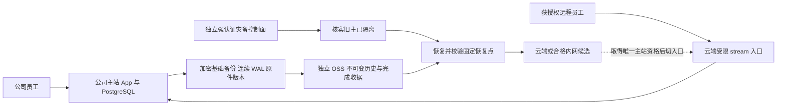

# 2026-10-23 灾备切换架构审查

本文是本轮新增云备份和云接管需求的独立架构审查，供正式设计引用。用户已允许云端保存业务备份，
平时公司本地主站办公，部分人员经云入口访问；发生故障后由超级管理员选择云端或合格的内网备用目标。
这取代先前本轮范围中的“云端不放业务备份”约束。本文不修改 ADR-183 的历史事实，
也不代表云业务数据库、完整切换或自动提升已经部署。第 8 节保留早期一次密文传输时的阶段事实。

本轮后续已落地每 5 分钟成套签名分块密文、小时整包、独立受限上传/保留和控制面状态发布。
当前实机范围、真实恢复收据、容量边界与未完成项以
[备份操作说明](../../deploy/dr-backup/README.zh-CN.md) 为准；连续 WAL/任意 PITR、云 WORM、
受控自动接管和控制面 SQLite 的异机反向备份仍未完成，不把本设计图当作实施验收。

## 1. ADR-183 能保留什么、必须新增什么

[ADR-183](../99-决策记录-ADR/ADR-183-本地业务服务与受控远程入口.md) 日常路径仍适合目前业务：
公司 Spring 和 PostgreSQL 是唯一业务执行点，云端只转发员工到公司的加密连接；数据库 SQL 不逐条跨 WAN。
保留本地优先、远程资格/MFA、公司侧限制隧道能力、写响应丢失不自动重放及唯一写主。

新增云接管意味着云端将在接管期间处理明文业务和密钥，不能继续对整台云服务器宣称
“从不持有业务数据、解密能力或域名证书私钥”。必须显式分开以下职责：

| 职责 | 正常模式 | 接管模式 | 不能取得的能力 |
|---|---|---|---|
| 既有云 stream 入口 | 转发员工内层 TLS 到公司 | 转发至已批准的当前主站 | 日常读取业务备份、业务密钥、源机 SSH 或删除历史 |
| 备份接收与验证 | 收已加密对象、验证摘要和恢复依赖、产生独立收据 | 继续保护历史并备份新主 | 提升数据库、改入口、解开业务密文或删除受保护历史 |
| 灾备控制面 | 只读状态、验证操作者、准备恢复环境 | 执行一次有固定目标/恢复点/epoch 的受控作业 | 提供任意 shell、任意 SQL 或绕过旧主隔离 |
| 备用业务执行环境 | 停止业务写、后台任务和对外办理 | 只在取得当前主站资格后运行业务 | 自动把旧主恢复为可写、向另一个可写库合并 |

同一 ECS 上的 Linux 用户和目录权限不能隔离已经失陷的 root。若既有公网入口与备用业务环境同机，
须接受该机器在接管时成为完整业务信任边界；“容器分开”也不能恢复 ADR-183 原有的云 root 失陷假设。
安全优先方案是保留低权限入口，把实际恢复执行放在独立 ECS 或从可信镜像创建的新实例，
不可变备份存独立 OSS 安全边界。现有 4 vCPU/8 GiB 机器可以作为首个受控候选，须依据现场盘点决定
是否承担入口、灾备控制、恢复业务等角色，不能因 CPU/内存数字足够就兼任全部信任职责。

首期建议采用“已准备软件的恢复环境 + 加密历史”，平时不在云端解开业务库，以已演练的恢复流程满足
四小时候选目标。若后来改成持续运行 PostgreSQL warm standby，云端平时就已经保存普通业务表的
可读数据；磁盘加密不阻止该机 root 读取运行数据库。此时须明确接受更大的日常云信任边界，
独立实例/身份和更短 RTO 的收益一起评审，不能继续沿用“云端平时只有无法解开的密文副本”的说法。



## 2. 只有一个可写业务站点，按钮不直接等于 promote

首期采用人工受控接管，不采用两地自动选主或双主。正常时本地主站继续独立办理，
云端或公网故障不使本地业务因等待远端确认而停写。因此不能同时承诺：网络分区时本地继续写，
管理员在云端无条件提升另一份副本，且两地永不分叉。

接管必须先取得可靠 fencing 证据：通过独立 BMC/受管电源确认旧主关停并阻止自动开机，
或在可达旧主上受控停写、停止全部写进程与数据库并撤销其重新取得生产角色的能力。
公司现场确认断电/物理隔离也可以是受控方案，但需要可核实的设备身份和操作记录。
仅关闭 HTTP、改 DNS、禁用一个管理员账号、停止一个 Spring 实例或关闭一个隧道都不够：
本地员工、定时任务、outbox 消费者、旧连接和直接数据库入口仍可能继续改变业务。

如果公司主机只是从云端不可达、也没有可验证的独立隔离通道，控制面可以完成隔离恢复和只读校验，
但必须拒绝发布可写主站。第三方 witness 或数据库中的 `primary_epoch` 只是协调信息，
在每个站点都能读取自己旧副本时，不能单独阻止双写。PostgreSQL 官方也要求防止旧主重新作为主库运行；
它不自带完成故障判断和选主的系统。[PostgreSQL 16 故障切换](https://www.postgresql.org/docs/16/warm-standby-failover.html)

每次作业绑定不可变的 `operation_id`、`expected_primary`、`target_site_id`、新 `epoch`、
恢复点、应用制品 SHA、数据/密钥清单摘要、隔离证据及操作者。控制面用 CAS 和单作业锁拒绝双击、
并行提升与旧页面提交。此 epoch 是恢复后各写入口与后台消费者核对身份的依据，不能代替硬隔离。
已被 fencing 的机器重启后默认保持隔离，只能被重建为新主的 standby，不能凭旧配置自行恢复生产。

建议状态机为：

```text
LOCAL_PRIMARY
  -> PREPARING（下载/隔离恢复，无业务写）
  -> OLD_PRIMARY_FENCED
  -> RECOVERY_VERIFIED（固定共同恢复点，接受实际数据损失范围）
  -> TARGET_PROMOTED（仍关闭员工业务入口）
  -> ACCESS_RECONCILED（撤旧会话、重核资格、关闭待核外部副作用）
  -> TRAFFIC_SWITCHED
  -> TARGET_PRIMARY
```

PREPARING 阶段失败可保留旧主继续运行。旧主已隔离以后失败，系统应保持停止办理并保留恢复证据；
不能自动重新开放两边。新主已经收到任何业务写以后，“取消”不是恢复旧 DNS，必须进入反向受控迁移。

## 3. 超管在主站故障时仍能进入控制面

仅在当前 ERP 设置中增加按钮会产生循环依赖：主站断电、数据库坏了或超管会话不可验证时，
该按钮恰好无法登录。应在正常运行时，为已有超级管理员登记独立灾备操作者身份，
使用独立管理入口和强认证；它不依赖生产数据库、生产 TOTP 解密或当前 ERP JWT 才能执行恢复。
可采用受管理设备与安全密钥，另保管受控离线恢复材料。它仅有固定灾备作业权限，不是公网 root 控制台。

控制面应能在公司服务器完全断电时，从允许的外部网络访问；也要有控制面自身所在 ECS 故障时的
受控运维入口。离线保管的内容包括身份恢复材料、接收解密私钥、可信公钥/主机身份、候选机器身份、
网络与证书恢复步骤。不能把唯一副本放在同一管理电脑的 DPAPI 中，也不能只放在被恢复的业务库里。
本轮已验证的 DPAPI 保护和加密私钥重导入，是本机可用性证据；两处独立离线托管尚未验收。

“超级管理员选择云端或内网目标”的含义应是选择已登记、能力检查通过的候选站点，
然后执行上述有持久状态的作业。不能允许填写任意 IP、上传任意恢复脚本或把探测超时解释为提升许可。
正常设置页可以查看状态并进入该控制流程，故障时仍用独立入口完成同一作业。

## 4. 恢复凭据、业务密钥与员工会话各自处理

备份中有数据库不代表业务可恢复。每个恢复点还需要对应的当前/历史 PGP 密钥、HMAC/AES-GCM
依赖及准确 issuer/AAD、受限恢复配置、原件引用、匹配的签名业务制品及校验软件。
业务 HMAC 或 PGP 不能为了换主临时随机重生成；可能同时破坏历史密文和确定性索引。
密钥清单须覆盖恢复点依赖的版本，而不是只保存最新一把。云端“有配置文件”也不能替代解密验证。

正常备份仅使用接收公钥加密；长期私钥不放生产机、旧 Windows 或公网入口。
受控接管时，经灾备操作者向隔离目标授予有时限的恢复解密能力，再把应用必需的密钥注入
目标私有配置；备份历史删除、云账号全权和其他站点管理密钥不进入业务进程。
使用 KMS 时也要检查角色边界：如果日常公网 ECS 的实例角色已经可以自行调用解密，
就不能再声称日常云入口没有解密能力。KMS 与客户端加密解决的边界须分别说明。

恢复后先撤销旧业务会话、刷新凭据和 MFA 证明，再要求重新登录。长期 MFA 因子是否保留，
应由实际解密验证及恢复策略决定；不能用历史会话直接放行。最近撤权/离职及远程资格可能晚于
恢复点，需要从独立保全的权限变更记录或受控人员名册复核，不能让旧备份恢复已被撤销的权限。
新增恢复代际应与“业务清空代际”分开；本次迁移和切换不执行业务清空。

本轮已有两条 AI `gh1` 凭据不能用当前配置通过解密验证，恢复时也不能假定它们自动可用。
可以明确暂停相关 AI 能力，待受权重新配置；不能覆盖原密文或盲换全局 HMAC 来使检查结果变绿。

## 5. 远程资格和日常入口在灾备时不能被隐式绕过

数据库写主角色、物理站点位置和请求来自公司/远程，是三个不同维度。
不能把云主站简单设置为 `site=local`，让原本仅内网员工自动绕过远程资格/MFA；
也不能直接复活退役 `application-cloud` 的逐条 WAN SQL 路由来承办日常业务。
需要明确新的“该站点是当前主站”角色，保留 connector 实际来源分类和现有授权。

普通远程人员继续使用显式授权和 MFA。公司主站故障时，原本仅本地使用的员工能否去云端，
必须预先设计：一种是事先登记灾备人员资格并预绑定因子，在实际接管状态下启用经审计的范围；
另一种是由独立于故障主机的公司网关建立受认证的灾备办公入口，云端按专用 connector 和受控
机器身份确认来源。不能用客户端 `X-Forwarded-For` 或一个可伪造头把公网请求标成内网。
现有五人远程授权容量也不会因为灾备自动变成全公司容量，必须在演练中验证实际人数和预算。

Web 保持同源静态资源与 `/api`。域名、内网 DNS/网关和批准客户端端点一起指向当前主站；
DNS TTL 和既有长连接意味着切换不是瞬时完成，旧端必须持续拒绝写，客户端重新获取状态并登录。
外网云入口仍可转发内层 TLS 到当前主站；云真正执行恢复后的业务时，需有独立受控的业务 TLS
私钥注入/续期方案，不能把公司离线 CA 私钥或全域 DNS 权限拷到公网入口。

已经发出但没有收到成功响应的订单、入库、支付或审批，按原业务单号/命令回执核对，
客户端和代理均不自动重放。数据库恢复还可能使 outbox、付款通知或第三方任务退回旧状态；
开放消费者前须核对外部已完成事实，不能假设全平台已有通用幂等。故障后保留草稿可以帮助人工
继续办理，不能把离线草稿队列当作两地主库自动合并协议。

## 6. 防止主机被攻破后把好备份一起删掉

需要两条独立通道：单向的恢复速度通道，以及有历史保护的备份通道。
物理复制、文件实时镜像和云磁盘快照可以缩短恢复准备，但会复制误删、坏数据或攻击后的写入，
不能代替可回到攻击前时点的独立历史。

现役 pgBackRest 仓包含可变元数据，不应给其活动目录直接套不可变锁或盲目 rsync 后宣称完成。
建议把经过一致性/引用校验的固定恢复集合、基础备份、WAL/timeline 及原件历史版本，
发布为独立、唯一命名的加密对象与完成收据。生产身份最多提交新对象，不能删除/覆盖受保护历史、
缩短保留期、关闭 WORM、修改生命周期或取得恢复私钥。接收验证身份、保留管理员、恢复操作者分离；
公网 ECS 的实例角色不获得整个账号的 OSS/KMS 管理权。

在独立备份 bucket 使用已锁定的不可变保护，并保存策略状态与拒绝覆盖/删除的实际负向证据。
OSS BucketWorm 新建后有 24 小时待锁窗口，未锁会过期；锁定后保留期只能延长，
受保护对象连 bucket owner 也不能修改/删除。当前官方文档允许 versioning 为启用或禁用，
不允许 suspended；不能沿用旧资料一概断言 WORM 与 versioning 不兼容。
[阿里云 OSS BucketWorm](https://www.alibabacloud.com/help/en/oss/user-guide/oss-retention-policies)

首选把独立、唯一命名的加密备份对象发布到受保护历史，不把当前业务 bucket 的 CRR 镜像当作
防勒索备份。OSS 2026-09-23 官方概要明确：即使规则只复制新增/修改，在启用版本控制时，
指定 version 的删除不传播，但源端 delete marker 仍会传播；不能声称靠该规则就屏蔽了全部删除标记。
若采用 CRR，必须核实实际 bucket 版本状态、规则和目标行为，让完成 manifest 绑定对象的确切
version ID 与摘要，并按该 version 恢复；即使 delete marker 使 latest 不可见，所需旧版本仍须受
WORM 保护并可读取。恢复程序不能依赖 latest 列表，验收须覆盖人工删除、生命周期删除和指定版本
永久删除。规则配置不能代替这些负向证据。
[阿里云 CRR 概要](https://www.alibabacloud.com/help/en/oss/user-guide/cross-region-replication-overview/)

复制身份使用有限的自定义角色，不套 OSS/KMS 全权系统角色示例，不能给予日常主机缩短保留期
或修改不可变策略的权限。
[阿里云同账号跨区域复制权限](https://www.alibabacloud.com/help/en/oss/user-guide/cross-region-replication-with-the-same-account)

传输校验是密文字节数/摘要、全部对象与清单引用闭合、目标持久完成收据及恢复验证，
不是只看上传命令退出 0、桶里文件数或 source 上的成功指针。源机被攻破仍可能提交新的坏备份，
所以须保留足够长的旧不可变历史，并由独立于源机的通道报告失联、恢复水位落后、异常增长和
恢复校验失败。源机、云机、管理电脑和备份账号共用一把管理员密钥会使这些边界失效。

## 7. RPO/RTO 必须覆盖数据库、原件和密钥依赖

沿用已有目标作为设计验收候选：最多丢失十五分钟、四小时内恢复。它们尚未被本轮实现证明。
数据库恢复时点必须有可恢复基线、连续 WAL 与正确 timeline；每个已提交原件引用还要有对应
provider/key/version 的可读对象；该点的密文依赖须有相应历史密钥。共同可恢复水位受数据库和
原件水位较早者限制，同时必须通过密钥版本覆盖检查，不能只看 standby 的 replay LSN。

当前每天两次配套备份最长间隔约十四小时三十分钟，不能用一份约 42 MB 的成功密文包证明
十五分钟目标。需要持续 WAL，以及保留历史版本的原件变更保护/接收确认。删除或覆盖旧对象前，
必须保证它在任一保留恢复点仍被引用时可取得；不能只复制当前 CLEAN 对象后删除远端旧件。
接收失败、对象缺件、目标满盘或密钥缺版本时不推进共同水位，报告实际可恢复窗口。

四小时预算包含：发现/人员到位、fencing、取得恢复能力、下载解密、数据库回放、原件恢复、
权限与财务库存核对、入口切换和用户重新登录。备用机器上有一个只读库，或者 `pg_restore --list`
通过，都不能等价于总恢复耗时已经达标。备份保留候选为 35 天 PITR、12 个周点、12 个月点，
须经实际增量/容量和不可变延迟测算，不能在未测容量时锁定过长政策，也不能到期按文件日期盲删链成员。

## 8. 两个已知候选的真实能力边界

| 候选 | 可以进入哪一阶段 | 仍缺什么 |
|---|---|---|
| 用户提供的阿里云 4 vCPU/8 GiB、Alibaba Cloud Linux 4 | 已盘点并收敛旧负载；已收到一次摘要一致的加密归档，可作为后续恢复候选 | 数据盘/IOPS/可用空间/带宽的容量验收、PG 主版本与扩展、精确应用运行环境、独立隔离/fencing 控制面、完整恢复演练 |
| 用户提供的 Windows Server 2008 R2 内网备用机 | 当前仅登记；连接恢复后可评估临时密文副本 | 实时网络身份与连通、磁盘健康/容量/ACL、受支持系统，以及全部业务恢复能力；不能因“开机且路由器有记录”就登记为可提升主站 |

本轮云端现场操作已停止原先运行的 8 个容器和 Nginx，9 个现有容器的 restart policy 均设为 `no`；
内存占用由约 5.2 GiB 降至约 0.8 GiB，外部 TCP 监听仅剩 SSH 22。约 42.3 MB 的加密归档已传到
`/srv/uten-imp-dr/inbox` 并核对 SHA-256 一致，接收私钥没有上传。这证明一次云端密文副本已经到达，
尚不证明持续备份、OSS 不可变历史、数据库恢复、业务可用或故障切换已实现。

旧 Windows 已结束支持，不开放生产解密材料、业务数据库或管理横向通道，不为复制开启 SMB1、Guest
或弱 TLS。保持密文副本能力与“可运行生产业务的备用站点”两个独立状态。
[Microsoft Windows Server 2008 R2 生命周期](https://learn.microsoft.com/en-us/lifecycle/products/windows-server-2008-r2)

现有行情 payload 校验器硬性要求 Ubuntu 24.04/x86_64/CPython 3.12。Alibaba Cloud Linux 4
不能只复制当前 venv 就视为兼容，更不能改 os-release 绕过校验。可以评估独立受支持的 Ubuntu
恢复执行环境，或为新平台完成有哈希锁的依赖/原生库与签名发行验证。OCR、ClamAV 和其他旁路服务
也要纳入恢复资源预算；现有应用允许的约 6 GiB 上限不能直接照搬到仅 8 GiB 的整机。
可在演练中定义清楚的应急功能范围，明确暂缓 OCR/行情等可选能力，同时保持核心原件可取与业务正确性，
而不是静默启动失败或把辅助服务失效显示为整个平台完全恢复。

## 9. 实施顺序与可交付的完成状态

第一批先完成独立加密不可变备份、目标读回、离线密钥托管和隔离完整恢复；这是目前最直接降低
单机故障/勒索后果的工作。正常本地业务和已有远程转发模式保持不变。

第二批准备与验证云备用执行环境、独立灾备身份、fencing 通道和持续共同恢复水位；
控制面先只允许“准备/演练”，在尚不能可靠隔离旧主前不提供可写接管。

第三批在受控演练中走完旧主断电、单纯断网、旧主恢复、目标满盘、云入口被隔离、
历史权限恢复、提交后丢响应以及原件/密钥缺件等具体路径，再开放超管的真实接管能力。
故障后旧主必须从新主重建/追平，完成反向备份和核对，在维护窗口再次 fencing 后才能切回本地；
不自动切回、不合并两份可写数据库。

每个目标分别显示：已登记、已联通、密文已验证、隔离恢复通过、可受控接管、当前主站。
一个状态不能代替后续状态；按钮可执行资格由后端核验证据，而不是管理员手填一个“ready=true”。
本文件仅给出上述设计边界，实际云端资源盘点、正式 ADR、变更清单和实施验收由后续工作分别记录。
