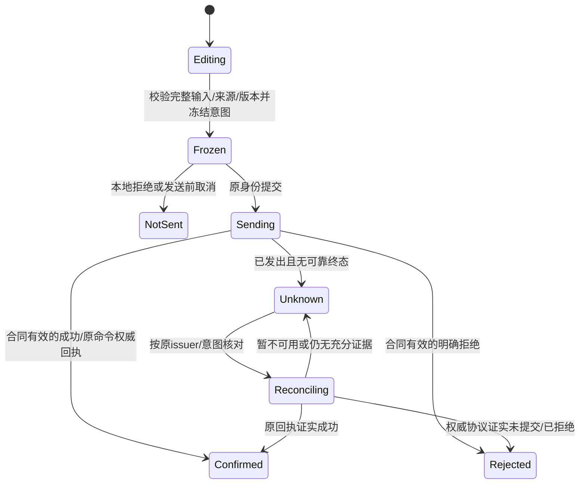

# Win7 原生兼容版：业务流程迁移与验收矩阵

本矩阵承接[总实施计划](00-总实施计划与交接入口.md)，用于把现有 Flutter/服务端的业务事实逐项迁入 C# WPF。**当前已验收的完整业务闭环为 0。** 登录、工作台、货品只读、包格式、下载按钮和编译成功均不计作业务闭环完成。

## 1. 检查基线与状态解释

| 项目 | 本次检查结果/使用方式 |
|---|---|
| 检查日期 | 2026-10-28；只读取当前独立工作树源码，没有连接生产业务、提交业务单据或执行数据库修复 |
| 分支/起点定位 | `uimp/win7-wpf-client-20261028`；检查时 HEAD 为 `005a31817`，但本文覆盖的 WPF/多运行时改动大量尚未提交，HEAD 不能代表这些文件的最终摘要 |
| 产品版本 | 当前 `pubspec.yaml` 为 `2.5.34+2534`；不表示现役服务器或员工客户端已升级 |
| 来源范围 | [`route_names.dart`](../../../lib/core/router/route_names.dart)、[`app_router.dart`](../../../lib/core/router/app_router.dart)、`lib/features/`、`lib/shared/`、`server/src/main/java/com/uten/imp/features/` |
| 覆盖基线 | [`migration-coverage.json`](../../../clients/windows_legacy/migration-coverage.json)：200 个路由常量、234 个 path 表达式、214 个页面入口、2 条部分只读路由、完整业务闭环 0；这些计数是不同粒度，不能相加 |
| 状态事实 | 以总计划指定的 `clients/windows_legacy/progress/work-items.json` 为唯一进度入口；本文的编号是拆分/验收索引，不单独累加完成比例，不手改生成清单的复选框 |
| 实施边界 | 本次只写计划；C#/Java 源码、业务数据库、SDK、系统证书及现网保持原状。后续仍在独立分支，不合并 `main`、不部署、不上传、不发布 |

文中“已有源码”只表示能定位实现；“本机检查”需要当前源码的可重跑结果；“目标机通过”需要 Win7 SP1 x86/x64 的实际交互。模块只有满足适用的全部 DoD、跨模块链及目标机验证后，才能由主登记表标为 `done`。确实不适用的动作须给 owning 源和理由，不能靠省略动作完成模块。

界面与相关设计采用 `frontend-design`，保留已有 Uten 主题、圆角、字体、表格/树、输入、选择器、键盘和权限提示。同源 token 由现有生成器维护，本矩阵不重新定义一套视觉常量。流程迁移必须同时覆盖 Web、Flutter 桌面及 WPF 的适用调用方；尚未迁入 WPF 的入口明确保持未迁移。

### 1.1 当前 WPF 真实范围

| 能力 | 已存在的 owning 源 | 当前可认定的范围 | 尚不能认定的范围 |
|---|---|---|---|
| 原生窗口、主题和工作台 | `Uten.Legacy.Desktop/MainWindow.*`、`Views/DashboardView.cs`、`Themes/`、`Controls/` | 原生壳、同源样式及部分工作台呈现 | 全导航、全部页面、全部语言/缩放/辅助功能、Win7 真机视觉与性能通过 |
| 认证基础 | `Uten.Legacy.Core/SessionCoordinator.cs`、`Models.cs`、`SessionStore.cs` | 登录携带初始 OTP、恢复、改密、注销、刷新单飞、issuer/认证代次/CAS、DPAPI 及持久待注销队列 | MFA 绑定/确认/停用/重置、敏感操作 step-up、模拟身份、完整员工权限生命周期已迁完 |
| 传输与读隔离 | `ManagedTlsHttpHandler.cs`、`ManagedHttp11.cs`、`ManagedCertificateValidator.cs`、`ReadScopeRevisionState.cs` | 固定依赖/公司 CA、有界 TLS/HTTP、GET、独立读范围代次与 opaque proof | 普通业务 PUT/PATCH/DELETE、任意业务 POST、业务命令恢复、上传及全部业务二进制合同 |
| 货品读取 | `Features/Goods/GoodsReadService.cs`、`GoodsWorkspaceView.cs` | 分类树、货品分页/筛选、UUID 详情，数字原文、服务端遮罩和读范围保护 | 货品新增/修改/停用/删除、BOM、价格、成本、导入、导出及完整历史工作流 |
| 下载/更新候选 | `Features/Downloads/`、`Updates/ClientUpdateCoordinator.cs`、`Core/ClientPackageDownload.cs`、`Uten.Legacy.Updater/` | 已有候选实现及局部测试入口；软件包下载已有独立流式 sink 源码 | 当前源码最终双架构/真实 TLS 大文件落盘/失败恢复整体验收、完整安装更新链、正式交付 |
| 通用业务写 | 目前只有认证交换；`SessionCoordinator` 对外没有完整业务 Mutation/step-up/draft/reconciliation 入口 | 无完整可写业务模块 | 采购、委外、生产、仓库、财务、销售、品质、HR/权限等不能标完成 |

上表 C# 路径均相对 [`clients/windows_legacy`](../../../clients/windows_legacy/README.zh-CN.md)。现有 `migration-coverage.json` 的 `notMigrated` 是覆盖基线说明，下载/更新等新增候选源码应由总登记表关联具体工作包和当前证据，不能据“文件存在”直接删除未迁移项。

## 2. 必须完成的跨模块链


箭头表示需要回归的来源/后置关系，不表示每条单据只能从唯一入口产生。手工、历史、补录、直接领用、退货、红冲等合法入口仍由各领域合同决定。

| 链编号 | 完整链及终点 | 回归必须核对的事实 |
|---|---|---|
| CH-01 | 物料分析 → 采购/委外拆单 → 财务批准 → 到货/IQC → 仓库 → 应付/抵扣/结算 | upstream UUID/行 ID、拆单商业条款、申请与下单数量、超收/短交、未检/未入库与实物库存分离、应付一次投影 |
| CH-02 | 生产计划/BOM → 执行/领料 → 车间材料 → 日报审核 → FQC → 成品入库 | BOM/单位/材料余额快照、真实出入库、材料处置来源、批量父回执、历史锁定与反向镜像 |
| CH-03 | 报价 → 财务/客户确认 → 销售订单 → 备货/分批发货 → 仓库出库 → 财务审核 → 收款 | 报价版本、信用/预收/部分发货资格、原订单行绑定、分轮数量、价格遮罩、应收/现金流及红冲一致 |
| CH-04 | 采购/销售/委外退货与报废 → 品质处置 → 库存/应收应付 → 反向处理 | 退货上限与原单、库存归属、原币/原单位、损耗/重量未知值、已处理下游保护，不能重新按最新单价改历史 |
| CH-05 | 员工入职/调岗/离职/返聘 → 账号/部门/权限/交接 → 任务可见范围/草稿 | 历史账号/别名、禁用状态、移交范围、任务领取、当前会话失效、旧草稿只读核对，不能凭打开页面触发修复 |
| CH-06 | 任一业务动作 → 附件/导出/打印/历史/审计 | 同一对象权限和字段投影、原始事实、查询筛选、生成版本、下载授权重检及本机交付结果 |

一个页面 CRUD 通过，不代表上述链通过。业务闭环的验收证据必须同时记录上游、当前单据、下游账/任务和反向操作。

## 3. 为什么 `GetAsync` 与认证写还不够

1. 当前 `ManagedHttp11`/传输只允许 GET、POST；普通业务还需要受控 PUT、PATCH、DELETE。认证 body 的 16 KiB 限制不等于 BOM、日报、批量单据的合法预算，扩大预算必须按动作、行数及服务端 `RequestLimits` 单独声明。
2. POST 不一律表示同一种写：品质队列 `/api/quality/pending-disposals/query` 是查询；导出创建、导出密码下载、打印授权也有各自语义。不能仅按 HTTP verb 判定可重试或幂等。
3. `LoginAsync` 等只提交认证 DTO。业务还要保留完整行集合、原始输入、字段缺省/显式清空、来源、版本、领取状态、快照 fingerprint、父子命令与逐行结果。
4. 不是所有接口都支持统一 `Idempotency-Key` 或 `expectedVersion`。源码中 `UnitSaveRequest` 和采购 `OrderSaveRequest` 没有可任意套用的通用版本字段；发出服务端不消费的头或 JSON 字段不构成并发保护。
5. `IsSubmissionUnknown` 是错误标记，不是业务命令账本。业务需要冻结命令、持久化未知状态、按原 issuer/账号/数据集核对回执，重启后继续核对，并阻止换键重发或删掉未知草稿。
6. 403 `REAUTH_REQUIRED`、`MFA_REQUIRED`、`READ_SCOPE_CHANGED`、普通 `FORBIDDEN` 不能走同一分支。step-up 的原冻结请求受控继续一次、MFA 的用户确认继续、读范围退役、无权限清空各有合同。
7. 软件包下载只接受固定 UUID/family 路径，不能直接当成附件上传、OSS 预签名传输、带密码的导出下载或打印服务。
8. 认证/读范围本机检查不能代替业务事务、库存、应收应付、历史、断网恢复和目标 Win7 的实际交互。

### 3.1 后续公共能力工作包

以下是拟定职责，不表示相同名称的类已实现。落地时先比较现有 Dart/服务端方案，再形成一个公共入口并迁移全部适用调用方。

| 能力编号 | 应形成的公共合同 | owning 源/必须保留的差异 | 可验证 DoD |
|---|---|---|---|
| CAP-MUT | 业务 Mutation：动作描述、HTTP 方法/路径、输入与响应种类、预算、身份/数据集/资源版本绑定、提交状态 | `lib/core/network/api_client.dart`、`safe_request_retry_interceptor.dart`、各 controller/DTO。空体成功、单对象、批次/部分结果分开；不能给无版本接口伪造版本支持 | 正常/拒绝/取消/超时/旧账号/旧服务/大 body/空体合同通过；调用方不另建网络客户端；业务写不因网络或 5xx 自动重放 |
| CAP-STEP | 串行再认证提示，`X-Uten-Step-Up` 绑定原用户/issuer/会话，空闲 5 分钟有效、连续授权操作复用并续期 | `step_up_coordinator.dart`、`step_up_interceptor.dart`；服务端 `security/RequiresStepUp.java`、`StepUpInterceptor.java`、`features/auth/StepUpService.java` | 同一会话的敏感动作可按服务端合同共用有效 token；取消/换账号不继续；只有服务端明确未执行业务的结构化 `REAUTH_REQUIRED`，经用户验证及再次确认后，才受控继续原冻结请求一次；不是 token 一次消费 |
| CAP-MFA | 登录 OTP 与会话内 MFA 验证/绑定/禁用/重置分离 | `features/auth/pages/remote_mfa_page.dart`、`RemoteMfaController.java`；`MFA_REQUIRED` 源合同要求验证后由用户继续原操作 | 初始 OTP、错误/过期/锁定、enrollment、停用及受控重置通过；不自动重放未知写；密码、OTP、恢复材料不入草稿/命令行/日志 |
| CAP-DRAFT | 持久编辑模型、输入原文、字段 presence、dirty/离开/关机/更新退出保护 | `lib/shared/drafts/form_draft*.dart`、`review_task_draft.dart`、`identified_platform_drafts.dart` | 命名空间含 issuer/账号/业务数据集/代次/表单种类/文档；完整模型不只可见行；未知命令不能删除/覆盖；权限减少可只读核对但不恢复写权 |
| CAP-REC | frozen command journal、回执查询、批次与逐行对账、结果收敛 | `businessIdempotencyKey`、日报 create/approve receipt、库存父回执、HR apply receipt；不把同名查到记录当成原命令回执 | 同键+同 payload 识别原意图，后续合法分轮用新意图；断网/重启/反向后仍核对原结果；无权威回执时保持未知并提供明确人工核对，不伪造成功 |
| CAP-NUM | 原始数值 lexeme、输入/展示分离、按合同精度/舍入的有界预览 | `lib/shared/measurement/`、财务精度工具、服务端 `BigDecimal` 领域计算 | 不统一成 `double`；C# `decimal` 只用于已证明在其精度范围内的合同；原币/原单位/原始金额输入、未知/估算/遮罩分别保留；Dart/C# 同组边界样例 |
| CAP-PERM | 动作权限、对象范围、服务端 capabilities、读范围、字段投影统一消费 | `route_access_policy.dart`、`permission_by_path.dart`、Dart `ReadScopeRevisionInterceptor`、服务端 `ReadScopeVersionAuthority` | 读范围不当认证代次；失权/冲突立即退役旧行/详情/导出；较晚旧请求不覆盖新 proof；查询界面与提交时权限均检查 |
| CAP-CLAIM | 任务领取/释放/接管、租约与提交资格 | `features/common/taskclaim/TaskClaimController.java`、`TaskClaimService.java`、HR 自有 claim 合同 | 失去领取/租约后不能确认旧快照；预览不等于占有；接管、取消、重新领取、两个客户端竞争均有明确结果 |
| CAP-STREAM | 唯一 TLS/HTTP framing + 有界 sink、哈希/长度/原子交付、上传描述 | 现有 `ClientPackageDownload.cs`、`HttpResponseSink.cs`、`ManagedHttp11.cs`；附件/导出各自增加受控适配器 | 软件包完整收口后再复用机制；普通 JSON 限额不扩大；身份改变/取消清自身 temp；预签名目标不转发 Bearer，不把任意 URL 塞入通用接口 |
| CAP-EXPORT | 查询/列/范围快照、异步 job、取消/过期/下载再授权、密码文件 | `shared/export/report_export_jobs.dart`、`order_documents_export.dart`、`features/reporting/export/ReportExportController.java` | 同筛选同投影；不是导出当前屏幕行；不能从隐藏列补出脱敏值；job 成功不等于下载完成，授权成功不等于交付；POST 密码下载走专用合同 |
| CAP-PRINT | 服务端原单打印快照/摘要授权、原生分页/预览/打印状态 | `shared/print/procurement_order_print_document.dart`、`core/print/`、采购/委外 `*PrintAuthorizationController.java` | 不重算历史单金额；变更权限/来源/快照后拒绝旧打印；取消选择器/取消打印不记已交付；Win7 两架构及真实打印机另验 |
| CAP-UI | 原生编辑表、筛选、树、选择器、批量选择、恢复提示、输入校验与异步呈现 | `lib/components/`、`lib/shared/widgets/` 与 WPF 主题/生成 token | 按同责语义迁移；虚拟化只影响呈现，不截断模型/批次；大表输入不中断；键盘/缩放/滚动/读屏及空值错误态可操作 |

> 再认证合同以可执行代码为准：`StepUpService.issue/consume`、`StepUpInterceptor` 和 `AuthSessionService.consumeStepUp` 实现同用户、同会话的空闲 5 分钟有效及成功使用续期。历史注释中的“一次性”若指 token 消费，与现执行行为不符；本矩阵中的“继续一次”仅指经确认后受控继续原冻结请求一次，不改变业务本身的版本、幂等和未知提交核对要求。

`CAP-REC` 与 `CAP-DRAFT` 是不同职责：前者描述已发命令/结果，后者保存尚在编辑的输入。恢复一个草稿不能替用户重新提交未知命令。

### 3.2 写操作必须采用的状态与核对规则



- `Frozen` 保存业务合同版本、完整 body、bodyHash/幂等键、资源版本/审核快照、来源行集合及原始输入；不生成另一种通用键取代领域既有算法。
- “发送前取消”与“发送后停止等待”必须区分。后者可能已提交，取消等待不回滚服务端，也不授权换键重试。
- HTTP 2xx 也要按动作合同解码：合法 void 是成功；预期回执缺字段、原始响应不完整、批次只有部分确认不能当作全部成功。
- 502/503/504、连接丢失、无结构化代码的 HTML/空体错误不能推断事务未发生；精确拒绝码、状态及业务合同共同决定结果。
- 旧身份结果不进入新界面；已知原意图和结果继续留在原命名空间核对。只有确认原请求的主体、命令和 payload 才能收敛未知状态。
- 每种动作分别登记回执查询方法。没有回执的接口须登记缺口/人工核对策略；不凭新增通用 request header、同名单据或最新列表结果“补齐幂等”。

## 4. 模块迁移矩阵

下面所有完整模块状态均为**未完成**。每项拆分还须映射到 214 页 owning 清单；同一动态页面承载多种单据时，按单据类型和动作分别验收，不只测一种 `kind`。

### 4.1 基础资料、BOM、价格与历史（MST）

**真实入口**：`/basicinfo/*`、`/basicinfo/history`；`basic_data/pages/unit_page.dart`、`goods_detail_page.dart`、`account_workspace_page.dart`、`import_review_page.dart`、`goods_price_analysis_page.dart`。后端主要为 `features/master/`：[`UnitController`](../../../server/src/main/java/com/uten/imp/features/master/unit/UnitController.java)、[`GoodsController`](../../../server/src/main/java/com/uten/imp/features/master/goods/GoodsController.java)、`GoodsBomController`/`GoodsBomEditController`、`GoodsCostSheetController`、`MasterLifecycleController`、`MasterRecordHistoryController`、`MasterInlineEditController`。

| 拆分 | 需迁入的行为 | 保护与 DoD |
|---|---|---|
| MST-01 选择器与主档读 | 分类树、搜索、筛选桶、分页、UUID 详情、引用选择、字段遮罩 | 当前仅货品部分可读；客户/供应商/账户/币种/单位/仓库/模具等各有权限；退出或读范围变更退役全部相关结果 |
| MST-02 完整单位维护样板 | `GET/POST /api/master/units`、`PUT /{id}`、`PATCH /{id}/status`、统一批量状态/删除、历史、导出 | 见第 6 节；计量维度及 mass code 的省略/清空必须区分，不能修改 legacy ID；在用计量规则由服务器拒绝 |
| MST-03 其他主档写 | 新增/编辑、停启用、引用保护删除、批量与 inline edit | 状态权限不能变成任意字段编辑权；客户财务字段、共同负责人、账户余额等按自己的合同保护，不能一套 DTO 全覆盖 |
| MST-04 BOM | 树编辑、粘贴、批量维护/替换、周期 BOM、where-used、导入 | 行来源、父子关系、精度、单位、循环/重复、被计划引用的版本及完整提交模型；不能只保存展开或可见节点 |
| MST-05 价格与成本 | 历史价、供应商价、默认条款、市场参考、成本表及原始输入 | “最近单据推断”与“主档默认条款”不能混用；价格遮罩不变成 0；历史按冻结来源和规则版本解释 |
| MST-06 导入/历史 | 上传、预检、问题明细、确认、操作历史/保留修订、导出 | 预览不等于落库；重复导入、部分失败、未知确认、软删除及历史附件均有原意图核对 |

**逐步验收**：MST-T01 从空数据新增单位后按 UUID 回查并显示原值；T02 仅 `unit:status` 的用户只能改状态；T03 修改时省略计量字段保留原规则，显式清空走服务端完整校验；T04 被库存/称重引用后变更计量维度被拒且输入仍保留；T05 两端同时编辑不覆盖未经确认的新状态；T06 同名/同编号冲突定位字段；T07 提交成功但响应丢失进入未知，不按名字自动认领；T08 批量删除含在用行时保持逐项结果与引用保护；T09 历史/导出使用同一权限投影；T10 Win7 x86/x64 表格、输入法、缩放和原生文件对话框实测。

### 4.2 采购（PUR）

**真实入口**：`/purchase/requests|orders|receipts|returns`；`purchase/pages/purchase_doc_list_page.dart`、`purchase_order_edit_page.dart`、`purchase_doc_edit_page.dart`、`purchase_doc_detail_page.dart`。权威入口：`purchase/request/PurchaseRequestController.java`、[`PurchaseOrderController`](../../../server/src/main/java/com/uten/imp/features/purchase/order/PurchaseOrderController.java)、`PurchaseReceiptController`、`PurchaseReturnController`、`PurchasePrintAuthorizationController`，以及 `finance/procurement/ProcurementFinanceApprovalController.java`、仓库 IQC/入库服务。

| 拆分 | 完整动作/真实 API 要点 | 保护与 DoD |
|---|---|---|
| PUR-01 申请与来源 | 申请来自既有分析/来源；`decomposition-preview`，申请行 `PUT /{id}/items/{itemId}/qty` | 不凭通用编辑器另造“任意新建申请”；被保护的生产来源不可随意修改 |
| PUR-02 订货编辑/拆单 | `POST /api/purchase/orders`、`/batch`、PUT/DELETE、`/{id}/cancel` | `purchase_order:create` 还需 `purchase_order:decompose`；按供应商及商业条款归集；完整输入/赠品/价税币种不丢失 |
| PUR-03 财务与改量 | `submit-finance`、`change-qty`、财务 task 批准/退回、受控结单 | 财务批准后受控改量须保留财务复核链，不能回写成普通草稿；差异数量由服务端阶段事实给出 |
| PUR-04 收退与后置 | 收货/退货 create/update/delete/approve/reverse，衔接到货/IQC/实入库、应付抵扣 | 收货单审核、IQC 与实际入库分开；原订单行、超收政策、退货上限、来源和库存/应付同步验收 |
| PUR-05 打印/导出/历史 | 原单打印、只读 `POST /api/purchase/orders/print-authorization`、列表/单据导出与历史 | 打印授权是摘要核对，不等于文件已交付；财务未批准与可否导出按当前服务端权限策略分别判断 |

**逐步验收**：PUR-T01 同货品不同供应商/币种/结算/税率正确拆单；T02 预填读取 `/last-terms` 的主档默认语义并保留 priceContext；T03 数量/赠品及总额输入按服务器规则反馈；T04 财务批准与退回后可用动作一致；T05 已批改量生成对应复核事实；T06 超收/短交/到货异常按权限进入各自处置；T07 收货 → IQC → 仓库入库 → 应付只投影一次；T08 退货/红冲受下游保护并反向账正确；T09 断网时原冻结 body/来源仍可核对；T10 失去价格权限后表格、详情、导出、打印均不泄露金额。

### 4.3 委外（SUB）

**真实入口**：`subcontract/pages/subcontract_business_list_pages.dart`、`subcontract_doc_edit_page.dart`、`subcontract_doc_detail_page.dart`、`subcontract_decomposition_page.dart`，仓库 `warehouse_subcontract_outbound*.dart`。后端为 `subcontract/application|inquiry|order|draw|material_issue|receipt|material_return|ret|waste|short_delivery` 各 controller，及财务委外损耗/结算领域。

| 拆分 | 完整动作 | 保护与 DoD |
|---|---|---|
| SUB-01 申请/询价/订货 | 申请拆解预览与 `items/{applicationItemId}/forward-bom`；询价保存/审核/反向；订货 create/batch、提交财务、改量 | 货品/颜色/供应商/工序与 BOM 来源不强合并；按既有商业条款拆分与权限显示 |
| SUB-02 领料/仓库出库 | `draw-tasks/preview|submit|withdraw`、任务关闭，发料编辑/审核/反向、`selected-outbound` | 请求领料、单据审核与实物出库不是同一事实；相同幂等意图不能再次扣料，所选行及领取资格必须冻结 |
| SUB-03 收货/退料/退成品/报废 | 各自保存/审核/reverse；仓库退回任务 | 按原归属、原单位/重量和授权来源处理；退料、成品退货、报废不能共用一个数量口径 |
| SUB-04 损耗/短交/结算 | `short-deliveries/{id}/decide`、损耗索赔/抵扣、财务结算 | 未知损耗/缺失换算率保留未知；短交处理不是任意减少订单；财务与库存后置只记一次 |
| SUB-05 输出/恢复 | 订单打印授权、过滤导出、历史分析/草稿恢复 | 界面、导出、历史一致解释来源；不能用当前剩余量改写旧回执 |

**逐步验收**：SUB-T01 多供应商/工序/单位拆解前后守恒；T02 同一来源行不能越权替换 BOM；T03 领料提交/撤回/仓库退回保持任务链；T04 两端竞争所选出库行，只有合法命令扣库；T05 退料/退货/报废分别核对库存归属及金额；T06 缺重量/换算率显示未知且不能静默记零；T07 短交决策及损耗索赔进入对应财务事实；T08 原命令未知时不允许重新拆一批；T09 反向后再次读取原回执不重复处理；T10 批量导出/打印均按原单权限与字段投影。

### 4.4 生产、MRP、执行与日报（PRO）

**真实入口**：`/production/material-analysis|plans|daily-reports|workshop-tasks|schedule|chain-health`，`production/pages/production_material_analysis_page.dart`、`production_plan_edit_page.dart`、`production_execution_batch_page.dart`、`production_daily_report_*`、`material_analysis_aggregate_submission.dart`。后端：`production/analysis/MaterialAnalysisController`、`AggregateMaterialOrderController`、`plan/ProductionPlanController`、`execution/*Controller`、`fulfillment/*Controller`、[`ProductionDailyReportController`](../../../server/src/main/java/com/uten/imp/features/production/dailyreport/ProductionDailyReportController.java)。

| 拆分 | 完整动作 | 保护与 DoD |
|---|---|---|
| PRO-01 分析/下单 | 物料分析、汇总单 `preview|submit`、action cancel、采购/委外/生产来源衔接 | 完整 BOM 与来源模型、需求/供应/借用/预计划互转；预览结果绑定提交快照，未知分析/提交不丢草稿 |
| PRO-02 计划 | create/update/delete、batch-approve/batch-delete、approve/reverse/flags | 行与版本、已执行/已领料下游限制；批量选择不是仅屏幕可见行 |
| PRO-03 执行 | execution-batches preview/submit；执行段 assignment、release-defer、dispatch、start、confirm-route、recheck-material、batch-start | 领取/负责人/车间、工艺及材料快照；预检通过后条件变化仍由服务端拒绝，不能靠按钮状态承诺成功 |
| PRO-04 领料/增料/发现 | workshop draw preview/submit；材料追加 request/approve/return/cancel，材料发现任务 | 领料、换料、追加与数量来源分别建模；保留可追溯来源，不能直接增大计划数来掩盖需求 |
| PRO-05 日报 | create、`POST /create-receipt`、update/delete、approve、material-review、approval-receipt、reverse | create 幂等键；approve V2 的 expectedVersion、V3 的 materialReviewFingerprint/materialDecisions；原回执与材料余额不可丢失 |
| PRO-06 调度/追溯 | 排产、看板、where-used、链健康、历史和报表 | 查询可取消、旧结果不回写新计划；链异常按事实定位，不在前端“补平”数量 |

**逐步验收**：PRO-T01 BOM/单位变化后旧分析快照不能直接提交；T02 汇总拆单的原始来源及去向可追溯；T03 计划批量操作保全成功/失败及原意图；T04 调度/领取改变后旧执行预览失效；T05 同一执行/领料命令丢响应后核对，不重新占用材料；T06 日报创建未知走原 create-receipt；T07 日报审核 V3 材料余额/可退来源变化被拒且保留决策输入；T08 部分已完成行与新未提交行分开恢复；T09 反向账、FQC 和完工入库前后数量一致；T10 大 BOM/日报连续编辑保持输入与主线程响应，不只提交可见行。

### 4.5 仓库、库存、车间材料与盘点（WH）

**真实入口**：`warehouse/pages/warehouse_*`、`stock_doc_*`、`stock/pages/instant_inventory_page.dart`、`/workshop-material/*`；[`StockDocController`](../../../server/src/main/java/com/uten/imp/features/stock/StockDocController.java)、`warehouse/inbound/ProcurementIqcStockInController`、`finishedin/ProductionFinishedInboundTaskController`、`stock/count/StockCountRequestController`、`stock/weight/StockWeightController`、`warehouse/materialbin/*Controller`、仓库任务中心/历史 controller。

| 拆分 | 完整动作 | 保护与 DoD |
|---|---|---|
| WH-01 仓库任务/到货 | 入/出/领料中心、采购/委外到货异常、完工到货批登记/反向 | 区分预计、登记、检验、待入与实入；仓库 UUID、库位、去向及 owner 按当前资格选择 |
| WH-02 单据与物理出库 | stock docs create/update/delete、approve-reviewed、approve-and-issue、issue、issue-batch、issue/reverse | 一步审核出库保持服务器原事务，不能拆成两个前端写；分轮 qty/重量/备注与同键回放规则保留 |
| WH-03 批量回执 | `GET /api/stock/docs/issue-batch/review`、`/issue-batch/receipt?idempotencyKey=` | 协议 2 的 DocumentReview/reviewToken、父回执冻结完整 docIds/items/weights；skipped/replayed 不再次扣库 |
| WH-04 IQC/成品实入库 | IQC pre-stock-in/confirm/batch-confirm；finished-in confirm/confirm-batch/reverse | 只把已授权合格/去向事实入库，批次与单行数量不越界；不能把品质通过直接当实物已入库 |
| WH-05 盘点/称重 | count requests submit/approve/reject/cancel；重量样本、profile、排除/恢复、余额设置 | 盘点、校正、单重学习分开授权；kg 与业务数量不能混加，0/未称/估算及历史镜像按原合同 |
| WH-06 车间材料/历史 | 机台/容器、材料选择/换料、盘点提交、期间关闭/重开、库存流水/追溯 | clientLineKey、期间/材料归属、来源、关闭后限制和库存镜像；追溯读取不反写历史 |

**逐步验收**：WH-T01 采购登记及 IQC 待入阶段不增加可用库存；T02 实入库一次增加账和流水；T03 分轮出库只扣本次数量，超过剩余被拒；T04 两端并发最后余额不为负；T05 父批次未知后按原键查回执，已出完/后来又有可出量也不重扣；T06 取消出库按原流水重量镜像，不按当前单重重算；T07 实称、未称、qtyFromWeight 分支按各自学习规则；T08 盘点审批与期间关闭/重开受权限/版本约束；T09 失去任务/仓库范围后清旧行和详情；T10 原单、库存、流水、来源追溯与反向记录共同核对。

### 4.6 品质：IQC、FQC、待处置与补产（QA）

**真实入口**：`quality/pages/quality_task_center_page.dart`、`quality_batch_approval_page.dart`、`production_fqc_inspections_page.dart`、`production_fqc_handling_page.dart`、`quality_pending_disposal_page.dart`；`warehouse/inbound/ProcurementInspectionController`、`ProcurementInspectionRecordController`、`production/quality/ProductionFqcInspectionController`、`ProductionFqcRecordController`、`ProductionFqcReplenishmentController`、`quality/pending/QualityPendingQueueController`。

| 拆分 | 完整动作 | 保护与 DoD |
|---|---|---|
| QA-01 队列/领取/附件 | 待检、待处置、报告与 inspection/lot 详情；POST query 的读合同 | task/browse 范围分别处理；只有当期对象授权可读附件/记录，不能拿列表可见代替处理权 |
| QA-02 IQC 决定 | dispose、pass-batch、decide-batch、decide-report 及对应 receipt | 行级来源/结果/处置去向、原命令/报告范围保留；一批部分确认与未知分开显示 |
| QA-03 FQC 决定 | decisions/pass-all、decisions/report、lots/{lotId}/decisions、{id}/decisions | 合格、不合格、处置/补产等事实按服务器 DTO；已完成行不能随新批次重新执行 |
| QA-04 后置/恢复 | replenishment material-analysis/material-confirmations，返工/报废/退回与成品入库 | 品质授权不是库存已入账；补产、材料分析、追溯与下游约束跨模块验收 |

**逐步验收**：QA-T01 无权浏览/处理者分别被阻止；T02 合格量与缺陷量、处置和报告范围按服务端验证；T03 单张/多张/批次选择完整且无遗漏重复行；T04 响应丢失仅核对原决定 receipt；T05 FQC 草稿中 completed、notSent、unknown 行各自恢复；T06 撤销/失去领取后旧弹窗不提交；T07 合格决定和实际入库分两步检查；T08 补产分析保持授权来源与原单位；T09 历史品质附件按当期对象策略；T10 断网/重启/账号切换后旧决定不进入新会话。

### 4.7 销售（SAL）

**真实入口**：`sales/pages/sales_doc_list_page.dart`、`sales_doc_edit_page.dart`、`sales_doc_detail_page.dart`、`sales_task_center_page.dart`、`sales_order_progress_page.dart`；`sales/quote/SalesQuoteController`、`SalesQuoteFinanceController`、`sales/order/SalesOrderController`、`SalesOrderFinanceConfirmController`、`sales/shipment/SalesShipmentController`、`sales/shipment/warehouse/WarehouseSalesOutboundController`、`sales/ret/SalesReturnController`。

| 拆分 | 完整动作 | 保护与 DoD |
|---|---|---|
| SAL-01 报价 | create/update/delete、submit/withdraw/reopen/reverse、customer-confirm/cancel/requote/convert、财务报价复核 | 报价版本、价格/额外列、原币与合同状态，客户确认和财务确认不能互相代替 |
| SAL-02 订单 | create/update/delete/approve/reverse、stopped/change-qty/cancel、partial-shipment-confirmation、priority/yield-reservation | 绑定原报价/订单行、数量变动引发的复核、预收/信用与部分发货资格按服务端决定 |
| SAL-03 发货与出库 | shippable-lines selection、发货 create/batch、confirm-sales/approve/reject/reverse、仓库出库 | 勾选快照、单行剩余、分批与库存来源；销售确认、仓库实出、财务审核分别有自己的状态 |
| SAL-04 财务与退货 | shipment finance-audit/reject/各类reverse/batch，销售退货 disposition/quality correct/dispose | 财务拒绝反向与库存红冲不混用；退货引用原发货、上限和品质处置，后续应收/收款一致 |
| SAL-05 历史/模板/输出 | 报价模板/学习回执、历史价、进度/报表/单据导出与打印 | 历史来源不以当前主档覆盖；脱敏金额不能从报价、额外列或模板旁路恢复 |

**逐步验收**：SAL-T01 报价提交/退回/客户确认/转单全过程；T02 两端编辑旧版本被正确处理；T03 财务未确认或信用/预收不足时不能借新客户端越权发货；T04 分批发货和余量正确；T05 同一库存来源不重复分配；T06 仓库出库、财务审核、应收及收款前后关联一致；T07 改量/取消/停止状态及复核资格正确；T08 销售退货与品质处置按原单数量和归属；T09 未知提交不换新单重发；T10 打印/导出/历史的币种、价格遮罩与来源一致。

### 4.8 财务、资金、结算、成本与总账（FIN）

**真实入口**：`finance/pages/finance_*`、`finance/payables/pages/finance_payables_page.dart`、`expense/pages/*`、`payroll/pages/*`；后端 `finance/procurement/ProcurementFinanceApprovalController`、`receipt/FinanceReceiptController`、`payment/FinancePaymentController`、`bank_transfer/FinanceBankTransferController`、`payables/SupplierSettlementController`、`SupplierOffsetController`、`ProcurementIqcRejectionController`、`gl/GlController`、`InventoryCostPostingController`、`asset/FixedAssetController`。

| 拆分 | 完整动作 | 保护与 DoD |
|---|---|---|
| FIN-01 审批任务 | 采购/委外财务任务、结单批量预览/申请、批准/拒绝；报价与发货财审 | 案例/任务/单据版本、原条款与改量差异，任务资格由领域服务判定，不能直接改业务状态 |
| FIN-02 收付/转账 | 收款、付款等 create/update/delete/approve/reverse；来源分配、预收/预付 | 原币、汇率、含税、折扣与分配不跨币种合并；审核/反向各写一次账及账户流水 |
| FIN-03 应付/结算/退货信用 | payables payment-preview；supplier settlements create/supplier-confirm/internal-confirm/dispute/reverse；IQC退货 record-return/confirm-credit/preview-credit/close-no-credit/reverse | 出库、应付抵扣、供应商确认不是一个状态；缺失对价、损耗、短交保留未知/争议，不推定已结清 |
| FIN-04 账户流水/对账 | `GET /api/finance/reconciliations` 及 facets，账户余额/账龄/应收应付 | 该 controller 是只读账户流水，不设计直接编辑流水按钮；需要 `account:view`、`account:balance:view`、`account:flow:view` 的组合权限 |
| FIN-05 总账/资产/成本 | gl generate/generate-all、line bindings、库存成本过账、固定资产、折旧及成本报表 | 服务器权威计算、来源证据、计价/会计期间/幂等，不能将 WPF 表格合计当过账依据 |
| FIN-06 报销/工资相关 | 报销提交/审批/支付/附件，工资批次创建/提交/审批/拒绝/发布及工资条授权读取 | 个人数据与财务权限分开；工资发布与支付、工资条下载授权不是同一事实 |

**逐步验收**：FIN-T01 多角色审批、领取/版本改变后的旧任务拒绝；T02 跨币种不能本地一列求和；T03 原始总额输入、舍入/税率由同组服务器样例核对；T04 断网后原收付款/过账结果先核对，不重复记账；T05 审核、反向、余额与流水账对平；T06 已结算/已分配/下游引用的单据不能绕过保护；T07 IQC信用与退货实物结果分别确认；T08 财务遮罩覆盖列表、明细、ZIP/PDF及历史；T09 异步总账生成、取消等待与实际事务终态分开；T10 账户流水保持只读并使用同一筛选投影。

### 4.9 HR、组织、账号与权限（HR）

**真实入口**：`employee/pages/*`、`hr_task/pages/*`、`hr_profile/pages/*`、`department/pages/*`、`admin/pages/admin_permissions_page.dart`、`profile/pages/*`。权威入口：`org/employee/EmployeeController`、`EmployeeCommandService`、`org/hrtask/HrTaskController`、`org/employee/reconcile/ReconcilePlanController`、`profileChange/ProfileChangeController`、`admin/AdminPermissionController`、`PermissionTemplateController`、`AdminUserController`。

| 拆分 | 完整动作 | 保护与 DoD |
|---|---|---|
| HR-01 员工/组织 | 员工 create/update、confirm、transfer、offboard、rehire，合同/头像，部门/副部门/岗位 | 在职状态、档案与账号 UUID、历史身份、交接关系、PII 字段及当前任务资格保留 |
| HR-02 账号生命周期 | account、lock/unlock、reset-password，手机号/身份变更 | 敏感动作按 RequiresStepUp；不能根据姓名或历史 alias 自动重绑/启用账号；旧禁用状态不被刷新复活 |
| HR-03 权限与模板 | 部门权限、baseline、权限模板、batch preview/apply/unbind、页面范围 | 可预览不等于可执行；基线、部门、个人、模板、数据范围和模拟身份分层；旧 view 的后台写与导出同时失效 |
| HR-04 领取/核对更正 | HR claims/release/takeover；reconcile plans id-repair/apply/discard、GET plans/{id}/applies/{requestId} | 原计划、requestId、逐行确认及同会话再认证；未知 apply 先读原回执；不可重跑历史修复作为兼容性办法 |
| HR-05 个人变更/工资访问 | profile change batches create/delete/review、我的档案、工资条 | 员工与审批者权限分开；原始证据、审批历史、被撤权后的只读核对、附件与下载口令按各自合同 |

**逐步验收**：HR-T01 入职到账号创建权限清晰且不重复建号；T02 调岗/离职影响旧任务、范围、导出和会话；T03 返聘保留历史而不复活不应启用的旧号；T04 仅查看角色不能通过 WPF 重置密码/改身份；T05 同一会话两个敏感动作可复用有效 step-up 并按服务端续期，失效或换会话后不得复用；T06 权限预览后条件变化按服务端拒绝；T07 核对 apply 丢响应后按原 requestId 查回执；T08 批量权限逐人/部门差异保留；T09 PII、工资、头像/证件附件不进入公共缓存/日志；T10 管理员切换/模拟身份不能把目标或旧管理员结果写入新会话。

### 4.10 附件、公司资料库、导入导出、打印（FILE）

**真实入口**：`company_files/pages/company_files_page.dart`，各领域附件组件；`lib/shared/attachments/`、`shared/export/`、`shared/print/`、`core/print/`。后端：[`AttachmentController`](../../../server/src/main/java/com/uten/imp/features/attachment/AttachmentController.java)、`CompanyFileController`、[`ReportExportController`](../../../server/src/main/java/com/uten/imp/features/reporting/export/ReportExportController.java)、采购/委外打印授权以及领域自身导入/导出 controller。

| 拆分 | 真实合同与动作 | 保护与 DoD |
|---|---|---|
| FILE-01 上传/确认 | attachments presign/confirm；local 原始字节 PUT /raw/{key} 携带 X-Uten-Attachment-Upload-Token；OSS 模式按返回目标直传 | 原始文件、ownerType/ownerId、大小/hash/type、上传token/issuer绑定；外部预签名目标不携带员工 Bearer，confirm 未知不能重复挂附件 |
| FILE-02 下载/预览/历史 | download-grant、preview、history/download、授权与恢复 | 本机路径与远程文件名分离；不任意重定向/信任 URL；历史 owner 策略、过期、文件不可用、同名保存、取消及原子交付均验收 |
| FILE-03 公司资料库 | folders/files/complete、rename/move/reorder/delete/restore、permissions/password/unlock/lock | `version`、文件/目录生命周期、密码与 RequiresStepUp；拒绝越权/路径穿越，不能删除共享 DPAPI/软件包/数据库备份 |
| FILE-04 导出 job | POST /api/report-export-jobs、recent/get/cancel、GET download-authorization、POST /{id}/download（密码） | 查询/列/范围/原始数值快照、创建结果未知、过期、取消及重新授权；POST 下载不能硬改成通用 GET 软件包接口 |
| FILE-05 导入 | 货品/BOM/成本等各领域导入/预检/确认 | CSV/XLSX 编码、列/单位/精度、批次问题定位、事务与逐行失败、原文件/确认意图及重复导入保护 |
| FILE-06 原生打印 | 原单快照 → 内容摘要授权 → PDF/原生预览 → 打印机/保存文件 | 原币/原单位/页码/换页/合计及历史快照；授权、生成、选择器、实际交付分别记状态，取消不记录已打印 |

**逐步验收**：FILE-T01 上传字节成功但 confirm 丢响应能查原事实；T02 原单被审核/红冲后分类和删除按 owner 策略锁定；T03 预签名域不收到 Bearer；T04 不同账号/服务/数据集不能交付旧文件；T05 大文件有限内存、错误/取消只清自身 temp；T06 导出不受分页/虚拟化可见行限制；T07 生成后撤权/改列权限拒绝旧导出下载；T08 密码不入命令行/日志/草稿；T09 打印授权后修改内容被摘要校验拒绝；T10 Win7 x86/x64 中文字体、分页、真实打印机、文件对话框及取消各有目标机证据。

### 4.11 认证、MFA、改密、会话和草稿（SEC）

真实来源包括 `auth/pages/login_page.dart|change_password_page.dart|remote_mfa_page.dart`、`features/auth/repositories/auth_repository.dart`、`core/network/interceptors/`、`shared/drafts/`；服务端 `AuthController`、`RemoteMfaController`、`StaffAuthenticationPolicy`、`AuthSessionService`、`StepUpService`。

| 拆分 | 当前与后续边界 | 验收要求 |
|---|---|---|
| SEC-01 已有认证基础补齐实测 | 初始 OTP 与改密不等于 MFA 全流程；恢复/注销队列/issuer/CAS 已有局部检查 | 当前源码重跑，Win7 两架构真实握手/原生窗口；账号停用/替换、损坏磁盘、DNS/IP/跨服策略逐项验证 |
| SEC-02 MFA 与再认证 | /auth/mfa/enrollment/confirm/verify/disable/users/{userId}/reset；/auth/step-up/activity | token 不跨身份/会话复用，同一会话的敏感请求按服务端合同复用并续期；弱网/失效/取消/锁定/换账号正确；MFA 通过后用户自行继续，不自动重放原未知写 |
| SEC-03 草稿/未知命令 | 继承 CAP-DRAFT/REC；日报/FQC/领料已有不同冻结格式 | 已提交单据与本地草稿不混同；旧 namespace 只在合法身份下只读核对；未知草稿不能批删/升级时抹掉 |
| SEC-04 退出/更新/重启 | 所有编辑器统一 IUpdateExitGuard/离开保护，再进入更新 ready 正常退出 | dirty、uploading、sending、unknown、confirmed-but-attachments-pending 分别处理；不能强制 Kill 省略保存/核对 |

**逐步验收**：SEC-T01 老刷新晚到不复活注销/切服；T02 明确失效与代理/5xx 暂不可用分开；T03 新旧账号/数据集草稿绝不串用；T04 step-up 换到新身份时旧动作不继续；T05 MFA 首次/二次校验与受控停用分开；T06 未知命令保持冻结、可核对但不可借恢复按钮重发；T07 数据集重置/版本改变时旧草稿被隔离且原文保留；T08 升级关闭前逐编辑器检查，确认前不退出；T09 退出持久化失败有明确错误和恢复栅栏；T10 损坏缓存、过期租约及历史读取均不回授写权。

### 4.12 其余页面不能遗漏（OTH）

| 页面组 | owning 源/后端入口 | 后续拆分及 DoD |
|---|---|---|
| 通知/建议/报销/工资 | `notice/pages/`、`suggestion/pages/`、`expense/pages/`、`payroll/pages/`；NoticeController、SuggestionController、ExpenseClaimController、PayrollController | 发布/提交/撤回/审批/支付/工资发布、附件/阅读/下载授权、历史与未知结果逐动作迁移；不因未在采购链图出现而遗漏 |
| 访客审批/保安/黑名单 | `visitor_approval/`、`security/`；VisitorApprovalController、SecurityVisitorController 等 | 员工侧待办与保安验放仍需验收；访客门户/退役重定向按 inventory 的实际 owning redirect 分类，不重新开放退役入口 |
| 经营工作台/研发任务 | `operations_workbench/pages/`、`rd_task/pages/`；FulfillmentWorkbenchController、RdTaskController | 业务来源、任务状态、跨模块跳转、批量导出、范围/领取及草稿完整链 |
| 官网询盘/网站管理 | `webinquiry/`、`website_management/`；WebsiteInquiryController 及 owning website 合同 | 询盘跟进/资料权限/附件、审计与关联客户；部署范围与用户暂停决定另核实，不能借客户端迁移自动发布网站 |
| AI/设置/审计/运维/灾备 | `admin/`、`settings/`、`disaster_recovery/`；AiChatActionController、SystemSettingController、ServerOperationsController、DisasterRecoveryEnrollmentController 等 | 普通查询与高风险操作分离；确认卡/step-up/原命令回执、权限、操作系统能力和维护窗口分别核对，不用通用 CRUD 面板替代 |
| 我的/部门/偏好/导航壳 | `profile/`、`department/`、`shell/`；MyProfileController、MyDepartmentController、UserPreferenceController | 权限可见、原始个人资料、偏好持久化、深链/返回/搜索、当前页面恢复及失权退役；同责入口全部接公共能力 |

这一组仍为未迁移/未完成。对不适用页面必须逐项写明旧源已退役、平台限制或用户决策及替代路径；不能用“其他”作为验收豁免。

## 5. 所有模块共用的验收底线

| 编号 | 场景 | 通过条件 |
|---|---|---|
| X-01 身份/来源 | A 账号在公司源加载/编辑，切到 B 或另一源后 A 的读写结果晚到 | 新视图、草稿、文件和 token 不被污染；原意图结果留原 namespace 可核对 |
| X-02 独立读范围 | HTTP 200 新 opaque proof、403 READ_SCOPE_CHANGED/FORBIDDEN、旧 seq 回复 | 按原合同退役旧行/详情/导出；不能用认证 Generation 代替全部读范围；普通共享刷新不被旧页取消 |
| X-03 并发/版本 | 两端同单据、预览后余额/工艺/权限/领取改变 | 明确冲突/重新核对，保留输入；无版本合同的端点先登记缺口，不装作已有乐观锁 |
| X-04 原始精度 | 大数、极小数、多位小数、负差额、原始金额输入、不同币种/单位 | 请求/响应数值原文保留，服务器最终计算；未知、未称、估算、遮罩各有自己的状态 |
| X-05 未知提交 | 已提交但客户端断网/响应截断/超时/进程重启 | 不自动重放业务写；原键、bodyHash、来源与审核快照持久化，按领域回执收敛；无充分证据仍是未知 |
| X-06 批量与全模型 | 分页、隐藏/折叠行、虚拟化、排序筛选改变、部分确认 | 完整所选集合与完整编辑模型提交；已确认/失败/未知分开，后续操作不重放旧父命令 |
| X-07 历史与反向 | 原单已被后续操作、红冲、旧数据缺少快照字段 | 按原事实/适用版本显示；反向镜像原流水，不能按当前默认值重算补零 |
| X-08 文件与输出 | 导出生成后失权、文件选择器取消、大文件中断、打印取消 | 没有未验证 final、权限外字段或已交付假记录；只清本操作 temp，不碰业务附件/备份/DPAPI |
| X-09 交互/响应性 | 目标最大行数、连续输入/粘贴、反复筛选/滚动/切页、后台计算和撤销 | 输入及模型完整、焦点/选择稳定，旧任务不能发布新视图；记录实际耗时/内存/帧/取消结果，不凭肉眼写“流畅” |
| X-10 平台/版本 | Win7 SP1 x86/x64，计划内 Win8.1，现有 Win10/11 Flutter | 原生控件/输入法/缩放/字体/打印/文件对话框/启动关闭实测；Flutter 默认接口、认证、更新独立回归 |
| X-11 发行 | 同审核源码/version/build 的各适用平台/family/arch 安装与 ZIP | 类型、实际位数、Release+Company、完整配对、下载/更新/清理/备份回滚分别验收；候选格式检查不等于正式支持 |

测试数据须在隔离 fixture/测试身份中建立，至少含两账号、两部门/仓库范围、两个 issuer、不同 businessDatasetId、价格可见/不可见角色、任务竞争者和原始历史缺字段样本。真实业务数据修复、账号重绑、库存/财务补账不是验收准备步骤。

## 6. 第一完整可写模块：单位主档维护

此模块依赖有界，能同时验证真实查询、表单、字段 presence、写权限、状态/删除、历史/导出和原生恢复，适合作为阶段 D 的第一个完整主档样板。其后立即进入采购 → 财务 → IQC/仓库 → 应付的跨模块链；完成单位主档不替代采购等交易流程。

### 6.1 先锁定的实际合同与缺口

- 来源为 `basic_data/pages/unit_page.dart`、`master/unit/UnitController.java`、`UnitService.java`、`dto/UnitSaveRequest.java`、`master/lifecycle/MasterLifecycleController.java` 与历史/导出公共入口。
- `UnitSaveRequest` 日常字段为 name/code/status；measurementDimension/massUnitCode 用 presence 标志区分“遗漏保留”与“明确清空”。在线新增不合成 legacy_id，关系继续使用 UUID。
- create 要求 `unit:create`；update controller 接受 `unit:edit`/`unit:status`，但服务端仍控制真实字段权限；状态存在独立 PATCH，不能把 status 权限做成全字段编辑。
- 在用计量规则及名称/编号冲突已有服务端保护；要用同组样例验证，而非照抄一个新 C# 换算器。
- **已发现的审计项**：该 save DTO 没有可直接传入的 expectedVersion 或幂等/创建回执字段，controller 也没有专用创建 receipt。局部实体版本、自增计量规则版本不等于用户看到的完整表单版本绑定。新增通用请求头不能弥补这个差异。
- 对这两个缺口先产出 owning 合同审计：哪些动作可用现有历史/状态做确定核对、哪些只能保持未知并人工核对、哪些需要向后兼容的服务端版本/回执增量。必要的后端/迁移工作另列任务并同步 Dart/WPF；本阶段不先改现役业务 Server，不弱化验收条件。

### 6.2 可交接的任务拆分

| 任务 | 前置 | 交付与 DoD |
|---|---|---|
| PILOT-01 合同/动作清单 | 阶段 A、本文及 owning 源 | 逐动作 DTO、权限、状态、输入 presence、冲突、回执/未知核对、历史/导出合同及原端调用；解决或明确登记上述版本/回执缺口 |
| PILOT-02 公共 Mutation/草稿接入 | CAP-MUT/NUM/PERM/DRAFT/REC；CAP-STEP 机制先形成但只在有 RequiresStepUp 的动作调用 | 页面只编排，不自己造 HttpClient、幂等哈希、命令 journal 或数字转换；复用唯一公共机制，保留不适用项理由 |
| PILOT-03 原生维护工作区 | PILOT-01/02、共享表单/表格/选择器 | 真正新增/编辑/状态及服务端验证错误定位；完整输入保留，关闭/导航/更新退出检查，非只读/占位按钮 |
| PILOT-04 生命周期/历史/输出 | PILOT-03、CAP-EXPORT | 单项/批量停启用和引用保护删除；历史及导出按 owning 源动作完整实现；原端没有的审批/打印明确不适用，不凭空加动作 |
| PILOT-05 跨端/目标机验收 | PILOT-01～04、隔离测试身份和数据 | 执行 MST-T01～T10、X-01～X-11 的适用项；同组 Dart/C# 样例、服务端事务及 Win7 双架构真实交互证据；未通过项目不能标 done |
| PILOT-06 复用回执 | PILOT-05 | 记录公共入口、所有调用方/旧实现清理、必要平台差异和扩展点；据此迁移其他主档，然后启动 CH-01 交易链 |

没有服务端权威证据时，按同名/同编号查到记录只能作为人工核对材料，不是自动判定“原提交成功”。如果合同审计确认需要增量回执或并发合同，它属于 PILOT-01 的真实依赖，不能在 UI 里绕开后假勾模块完成。

## 7. 阶段顺序、依赖与退出条件

| 对应总阶段 | 本矩阵顺序 | 进入下一项的证据 |
|---|---|---|
| A | owning 页面/路由/控制器/动作与历史/退役分类，映射本文编号到主 registry | 200/234/214 的正确粒度与来源指纹；新增发现任务有稳定 ID，无第二套进度计分 |
| B + C | CAP-MUT、STEP、MFA、DRAFT、REC、NUM、PERM、CLAIM；共享原生表单/编辑表 | 公共合同、Dart/C# 同组正反例、取消/未知/并发/响应性与实际适配器检查；不可由每个页面复制实现 |
| D 主档样板 | PILOT-01～06 单位维护，随后其他主档选择器/主档写/BOM/价格基础 | 第一完整可写主档达到全动作 DoD，不停留新增按钮或保存单一路径 |
| D 交易样板 | CH-01：采购/委外来源 → 财务审批 → 到货/IQC → 仓库/应付 | 多角色、真实账/来源、未知核对及反向结果；依赖模块未就绪时不能只演示采购保存 |
| E | CH-02/03/04 生产、品质、销售、退货；HR/权限与附件/输出并行按依赖落地；OTH 全覆盖 | 各模块及所有变体/子流程逐动作证据；前端/服务端/其他客户端变更同时核对 |
| F + G | 安装/原生更新、每组合双包、多运行时 catalog/下载/备份 | 业务草稿/未知意图保护接入退出 guard；实际 Setup/ZIP 与故障恢复/保旧组核对，独立于模块源码完成 |
| H | 所有适用业务、Win7 x86/x64、Win10 Flutter 独立回归和交接 | registry 的 done 均有匹配源码证据；缺目标机或发布条件的状态保持未验收；仍不合主链 |

安装更新、主题、文件传输等无依赖部分可以并行推进；这不取消第一完整可写模块及跨模块链门槛。没有依据的工期或总百分比不在本矩阵估算。

## 8. 每个模块应提交的验收回执

```text
主任务 ID / 本矩阵场景 ID / 模块与页面变体：
分支、commit或候选文件指纹、配置/规则/DTO版本：
修改分类：前端 / 后端 / 共享契约；适用 Web / Flutter / WPF / 架构：
owning 页面、controller/service、公共入口、全部调用方与保留差异：
测试身份/数据集/来源、上游单据/任务/历史与前置状态：
具体动作、原始输入、版本/领取/快照、命令标识及结果：
正常 / 拒绝 / 并发 / 断网 / 取消 / 重启 / 未知核对 / 反向：
库存、财务、来源、历史、权限/字段投影核对：
附件 / 导入导出 / 打印 / 草稿 / 更新退出适用结果：
公共单测 / 实际调用方 / 目标机交互性能 / 原Win10回归证据：
失败、跳过、不适用原因、缺失合同及下一步：
```

现有测试文件可作为样例与回归候选，例如 `PurchaseOrderCommercialSplitTest`、`PurchaseOrderSourceMergeSplitTest`、[StockDocIssueBatchContractTest](../../../server/src/test/java/com/uten/imp/features/stock/StockDocIssueBatchContractTest.java)、[DailyReportV3ApprovalLifecyclePostgresTest](../../../server/src/test/java/com/uten/imp/businesschain/DailyReportV3ApprovalLifecyclePostgresTest.java)、[UnitMassUnitCodeTest](../../../server/src/test/java/com/uten/imp/features/master/unit/UnitMassUnitCodeTest.java)、`ProductionFqcRecoveryPostgresTest`、`StepUpAdvisorConfigTest`、`ReadScopeVersionAuthorityTest` 等；**发现了测试文件不表示本次已运行**。数据库/业务整链测试必须在隔离环境使用对应当前代码，不能把历史绿色结果改名为 WPF 通过。

## 9. 当前暂停点与下一位接手的第一步

1. 先阅读 00、主进度清单及当前接手记录；核对独立分支、HEAD/dirty、当前源指纹，保留所有并行改动。本文写作没有变更 C#/Java 或主 registry。
2. 收口已在分支中的流式下载和安装更新候选：当前新 API 已有局部检查，但仍需最新源码的双架构、真实 TLS 大文件落盘、账号切换/失败、ready/正常退出/恢复及同源候选包验证。
3. 新 WPF ZIP 的最新统一合同是**固定 6 文件、无 ico、显式 packageKind=update、累计展开严格小于 1 GiB**，Flutter 历史合同保持原样。检查时 Java `WindowsWpfPackageInspector.allowedFile` 仍容许 ico，公共展开上限仍是 2 GiB，必须在后续代码阶段按新 WPF 门收紧并重跑；不能把之前 55 项服务器回归当作这个最新收紧已通过。
4. 源码读取/认证与下载局部检查均不是完整业务迁移。先落实 CAP-MUT/STEP/DRAFT/REC 的描述与合同样例，再执行 PILOT-01 单位维护合同审计；按 PILOT-02～06 做出第一完整可写模块，随后 CH-01。
5. 主 registry 由 root 维护；本文只提供拆分和验收依据，等待接续任务关联，不给业务模块勾完成。不合并 `main`，不上传、部署或发布。

全文目标是让接手者能从真实缺口继续推进全部业务，而不是把迁移范围收缩为登录、只读页面或下载演示。发布、Win7 真机、完整 ERP 等价与本机源检查始终分开记录。
